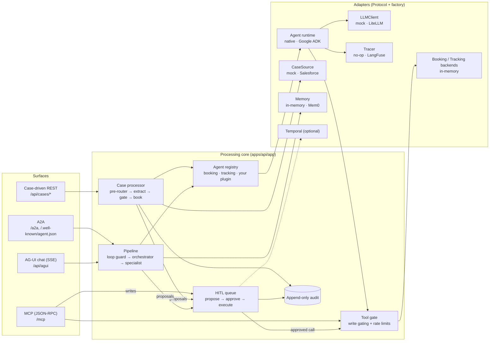

# casepilot

**casepilot** is a reference implementation of a **case-driven agent automation platform** for container
shipping. Inbound CRM cases are pre-routed by their "reason for case", an extraction agent turns the email into a
structured booking request, and a booking agent either executes the booking or **proposes** the exact tool call.
Proposals wait in a confidence-gated human-in-the-loop (HITL) queue, and approving one runs exactly the proposed
call. Writes are shadow-first, every decision lands in an append-only audit trail, and the same core is exposed
over four surfaces: case-driven REST, A2A, MCP and AG-UI chat. Every external integration (Google ADK, LiteLLM,
LangFuse, Mem0, Temporal, Salesforce, Promptfoo) is optional and off by default, so `make demo` runs the whole
flow offline.



## Key ideas

- **Shadow-first.** `CASEPILOT_WRITE_MODE=shadow` (the default) means case processing never writes: every write
  becomes a HITL proposal. Switch to `live` once the eval gate says the extraction is good enough, and then only
  confident, complete cases write on their own.
- **Propose, then approve.** In a read-only session the write tools are withheld, so the booking agent returns a
  `proposed_call` (`{"tool", "arguments"}`). Approval runs that call through the gate. The model is not run again,
  so what the operator approved is what executes.
- **Registry-driven agents.** A specialist agent is an `AgentPlugin` registered at import time. The orchestrator's
  intent list, the A2A agent card and the admin UI all read the registry, so adding an agent never touches the
  pipeline.
- **One gate for every tool call.** The native runtime, the ADK runtime, MCP and HITL approval all call
  `app/agents/runtime/gate.py:execute_gated`, which refuses unpermitted writes and applies per-caller rate limits.
  Write permission is seeded by the platform, never by the model.
- **Pluggable runtime and integrations.** Each integration is a `Protocol` with a factory, a `set_*` override for
  tests, and an optional extra in `pyproject.toml`. The default install needs no network and no API keys.

## Built with

Full table with licences, file paths and enable switches: [docs/integrations.md](docs/integrations.md).

| Product | Role | On by default? |
|---|---|---|
| [FastAPI](https://fastapi.tiangolo.com) + Uvicorn | HTTP API for all four surfaces | Yes |
| [Pydantic](https://docs.pydantic.dev) + pydantic-settings | Request models, extraction schema, `CASEPILOT_*` settings | Yes |
| [SQLAlchemy](https://www.sqlalchemy.org) + [Alembic](https://alembic.sqlalchemy.org) | Async ORM and migrations | Yes |
| [PostgreSQL](https://www.postgresql.org) (asyncpg) / SQLite (aiosqlite) | Database (Postgres in dev/prod, SQLite for demo and tests) | Postgres for `make dev`, SQLite for `make demo` |
| [httpx](https://www.python-httpx.org) + [PyJWT](https://pyjwt.readthedocs.io) | Salesforce client, JWT bearer auth | Yes (used when enabled) |
| [Google ADK](https://google.github.io/adk-docs/) | Alternative agent runtime (`LlmAgent`) | No (`CASEPILOT_AGENT_RUNTIME=adk`) |
| [LiteLLM](https://docs.litellm.ai) | One client for OpenAI, Bedrock, Azure OpenAI, Anthropic, Ollama, ... | No (`CASEPILOT_LLM_PROVIDER=litellm`) |
| [LangFuse](https://langfuse.com) | Traces for every pipeline, agent, tool call and generation | No (`CASEPILOT_LANGFUSE_ENABLED=true`) |
| [Mem0](https://mem0.ai) | Semantic customer memory | No (`CASEPILOT_MEMORY_BACKEND=mem0`) |
| [Temporal](https://temporal.io) | Durable case workflow, signal-driven approval | No (`CASEPILOT_TEMPORAL_ENABLED=true`) |
| [Salesforce](https://developer.salesforce.com) | Case source (JWT bearer flow + SOQL) | No (`CASEPILOT_CASE_SOURCE=salesforce`) |
| [Promptfoo](https://www.promptfoo.dev) | Routing eval against a running API | No (`make eval-promptfoo`) |
| [React](https://react.dev) + [Vite](https://vite.dev) + [Tailwind CSS](https://tailwindcss.com) | Admin console | Yes (`make admin`) |
| [assistant-ui](https://www.assistant-ui.com) + [AG-UI](https://docs.ag-ui.com) | Chat thread over the AG-UI event stream | Yes (Chat page) |
| A2A and MCP | Agent protocol surfaces | Yes |

## Quick start

### Zero dependencies (SQLite + mocks)

```bash
make demo       # API on http://localhost:8000, 8 sample cases seeded
```

Needs only [uv](https://docs.astral.sh/uv/) (`uv run` installs the base dependencies on first use). `make demo` uses SQLite (`apps/api/casepilot-demo.db`), creates tables on startup and seeds the sample cases
from `apps/api/app/seeds/sample_cases.json`. The LLM is a deterministic mock, so no API keys are needed.

### Full stack (Postgres + admin UI)

```bash
make install    # uv sync --all-extras + npm ci
make dev        # Postgres (docker compose) + migrations + API on :8000 + admin on :5173
```

Open http://localhost:5173. Or run everything in containers with `docker compose --profile app up --build`
(API on :8000, admin on :8080).

### Walk-through: case → proposal → approval → booked

With the API running (`make demo`, or `make dev` with `CASEPILOT_SEED_ON_STARTUP=true` or a manual pull):

```bash
API=http://localhost:8000

# 1. Pull cases from the configured case source (the mock serves the 8 sample cases; repeat pulls are idempotent)
curl -s -X POST $API/api/cases/pull
# {"pulled":8,"created":8}   (created is 0 if startup seeding already ran)

# 2. Process the Rotterdam → Singapore booking request (CASE-0001)
CASE=$(curl -s "$API/api/cases?limit=20" | jq -r '.items[] | select(.external_id=="CASE-0001") | .id')
curl -s -X POST $API/api/cases/$CASE/process | jq '{status: .case.status, item: .case.hitl_item_id, reason: .result.hitl_reason}'
# {"status":"hitl_required","item":"<uuid>","reason":"Shadow mode: writes need operator approval"}

# 3. Inspect the proposal: exactly the call that will run on approval
ITEM=$(curl -s "$API/api/hitl/queue?status=pending" | jq -r '.items[0].id')
curl -s $API/api/hitl/queue/$ITEM | jq '.payload | {tool, arguments}'

# 4. Approve it: the platform runs booking_create through the gate with write permission
curl -s -X POST $API/api/hitl/queue/$ITEM/review \
  -H 'Content-Type: application/json' -d '{"decision":"approve","note":"checked"}' | jq '{status, ref: .result.result.booking_ref}'
# {"status":"executed","ref":"BK-200001"}

# 5. The case is booked, and the audit trail shows every step
curl -s "$API/api/cases/$CASE" | jq '{status, booking_ref}'
curl -s "$API/api/audit?limit=10" | jq -r '.items[].event_type'
# case.booked, hitl.executed, hitl.approved, case.hitl_required, hitl.submitted, cases.pulled
```

The same flow over the agent surfaces is in [docs/protocols.md](docs/protocols.md).

## Repo layout

```
apps/
  api/                  FastAPI service (Python 3.12, uv)
    app/agents/         plugin + tool registries, orchestrator, extraction, booking, tracking, case processor
    app/agents/runtime/ run_agent dispatcher, native tool loop, Google ADK runtime, the tool gate
    app/agents/llm/     LLMClient protocol, deterministic mock + mock scripts, LiteLLM adapter
    app/agents/graphs/  stateless graph shim, loop guard, the A2A/chat pipeline
    app/agents/memory/  MemoryStore protocol, in-memory store, Mem0 store
    app/integrations/   case source (mock, Salesforce), booking + tracking backends (in-memory)
    app/services/       case lifecycle, HITL queue, interactive escalation
    app/routers/        REST, A2A, MCP, AG-UI
    app/temporal/       durable case workflow, activities, worker
    app/observability/  tracer seam (no-op, LangFuse)
    alembic/            migrations (append-only audit trigger on Postgres)
    evals/              offline routing eval + Promptfoo config
    tests/              offline test suite (SQLite in memory, mock LLM)
  admin/                React 19 + Vite + Tailwind 4 operator console
docs/                   guides, reference and decision records
.github/                CI, CodeQL, image publishing, eval gate, Dependabot
docker-compose.yml      Postgres, Temporal dev server (profile temporal), API + admin (profile app)
Makefile                every common workflow (`make help`)
```

## Documentation

| Doc | What it covers |
|---|---|
| [docs/README.md](docs/README.md) | Docs index |
| [docs/architecture.md](docs/architecture.md) | Components, request lifecycles, data model, safety layers |
| [docs/case-pipeline.md](docs/case-pipeline.md) | Pre-router → extract → gate → book, case statuses, sample cases |
| [docs/hitl-and-shadow-mode.md](docs/hitl-and-shadow-mode.md) | Shadow-first, propose-then-approve, corrections, go-live ramp |
| [docs/protocols.md](docs/protocols.md) | A2A, MCP and AG-UI with curl examples |
| [docs/agent-plugin-contract.md](docs/agent-plugin-contract.md) | Add a specialist agent (worked example) |
| [docs/tools-and-gating.md](docs/tools-and-gating.md) | `@tool`, READ/WRITE, the gate, rate limits, loop guard |
| [docs/integrations.md](docs/integrations.md) | Every product and service casepilot uses, with licences |
| [docs/temporal.md](docs/temporal.md) | Durable workflows, local dev server, Temporal Cloud |
| [docs/configuration.md](docs/configuration.md) | Every `CASEPILOT_*` setting |
| [docs/evals-and-ci.md](docs/evals-and-ci.md) | Evals, GitHub workflows, Dependabot |
| [docs/api-reference.md](docs/api-reference.md) | HTTP contract |
| [docs/decisions/](docs/decisions/README.md) | ADRs and RFDs |

Contributing: [CONTRIBUTING.md](CONTRIBUTING.md). Security: [SECURITY.md](SECURITY.md).
Changes: [CHANGELOG.md](CHANGELOG.md).

## Licence

[MIT](LICENSE). Copyright 2026 The casepilot authors.
