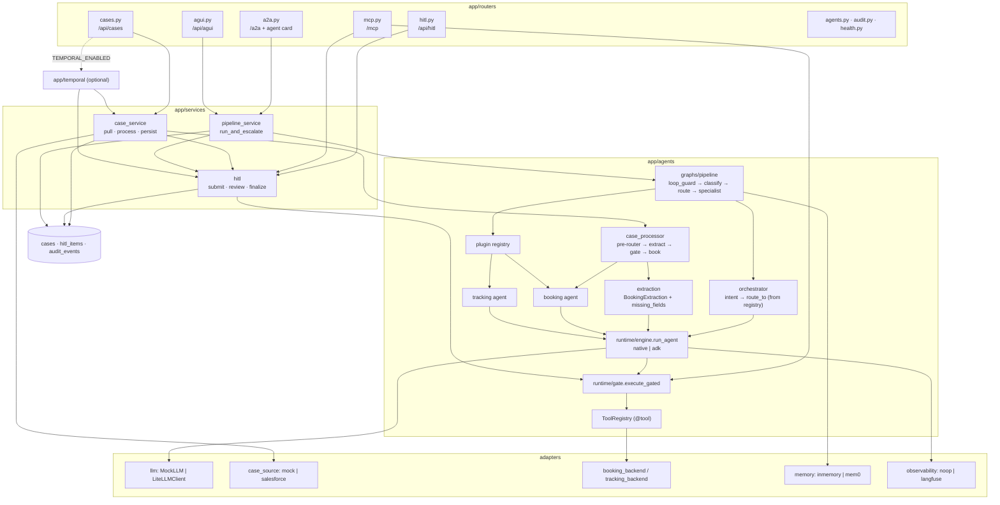
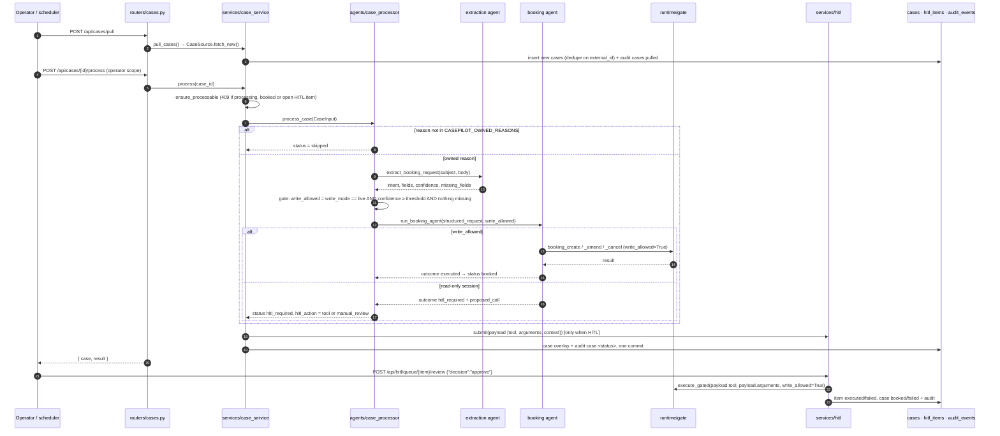
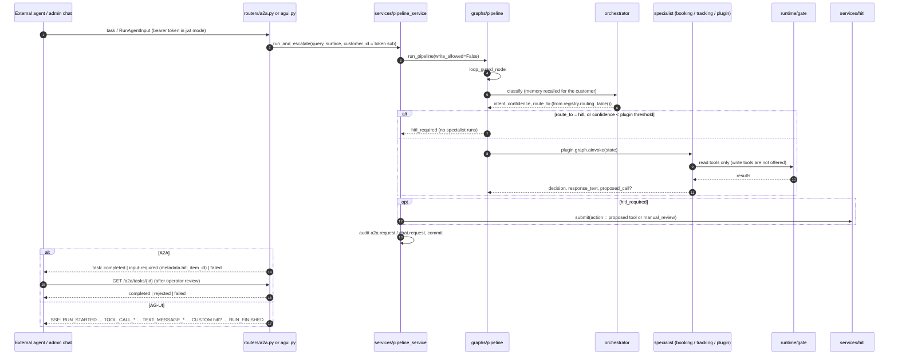
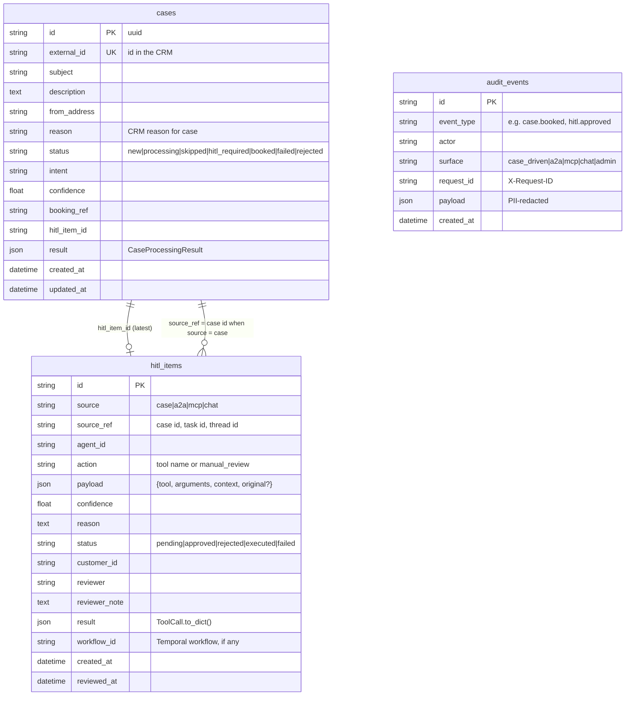

# Architecture
*explanation · last updated 2026-10-09*

## Purpose
How casepilot is put together, for contributors and integrators: the components, what happens on each surface
from request to response, the three tables, and the safety layers every request passes through.

## TL;DR
- **One core, four surfaces.** Case-driven REST (`/api/cases/*`) runs the deterministic case processor; A2A
  (`/a2a`) and AG-UI chat (`/api/agui`) run the orchestrator pipeline; MCP (`/mcp`) calls tools directly.
- **Interactive surfaces never write.** A2A, chat and MCP run read-only; any write becomes a HITL item. Only case
  processing in `live` mode, or an operator's approval, can write.
- **Every tool call goes through one gate** (`app/agents/runtime/gate.py`): write gating, then rate limiting.
- **Three tables**: `cases`, `hitl_items`, `audit_events` (append-only, enforced by a Postgres trigger).
- **Everything external is an adapter** with an offline default; see [integrations.md](integrations.md).

## Components

| Component | File(s) | Responsibility |
|---|---|---|
| App factory | `app/main.py` | Loads plugins (`load_plugins`), optionally creates tables and seeds cases, mounts routers, CORS, request ids |
| Settings | `app/config.py` | Every `CASEPILOT_*` switch ([configuration.md](configuration.md)) |
| Plugin registry | `app/agents/plugin.py` | `AgentPlugin`, `registry`, `routing_table()`, `load_plugins()` |
| Tool registry | `app/agents/tools.py` | `@tool`, schema derivation, `get_scoped_tools`, `write_tools_for` |
| Runtimes | `app/agents/runtime/engine.py`, `native.py`, `adk_engine.py` | `run_agent(config, messages, ctx, budget) -> AgentResult`; native loop or Google ADK |
| Gate | `app/agents/runtime/gate.py` | `execute_gated`: write gating + rate limiting for every tool call |
| Orchestrator | `app/agents/orchestrator.py` | Tool-less intent classifier; the registry, not the model, picks the destination |
| Extraction | `app/agents/extraction.py` | Case text → `BookingExtraction`; code computes `missing_fields` and caps confidence |
| Booking agent | `app/agents/booking.py`, `booking_tools.py` | Create / amend / cancel / status; proposes writes it cannot make; `enforce_invariants` |
| Tracking agent | `app/agents/tracking.py`, `tracking_tools.py` | Read-only milestones and ETA |
| Case processor | `app/agents/case_processor.py` | The deterministic case path; pure (no DB writes) |
| Pipeline | `app/agents/graphs/pipeline.py`, `mini.py`, `loop_guard.py`, `nodes.py`, `state.py` | The synchronous A2A/chat path on a tiny stateless graph shim |
| Services | `app/services/case_service.py`, `hitl.py`, `pipeline_service.py` | Persistence, HITL submission/approval/execution, audit events |
| Guardrails | `app/agents/guardrails.py` | PII redaction and denied topics |
| Audit | `app/audit.py` | `emit()`: PII-redacted, same transaction as the state change, mirrored to the `casepilot.audit` logger |
| Security | `app/security.py` | `Principal`, mock vs JWT auth, `require_scope`, `require_operator` (`casepilot.operator`) |
| Temporal | `app/temporal/` | Optional durable `CaseWorkflow` ([temporal.md](temporal.md)) |

## Request lifecycle per surface

### Case-driven (`POST /api/cases/{id}/process`)

With `CASEPILOT_TEMPORAL_ENABLED=true` the same steps run inside `CaseWorkflow`: `process` returns
`{case, workflow_id}` immediately, and approval signals the workflow, which runs the call in an activity
([temporal.md](temporal.md)).

### A2A and chat (`POST /a2a/tasks/send`, `POST /api/agui`)

### MCP (`POST /mcp`)

MCP skips the agents entirely: an external agent calls tools by name. `tools/list` shows only tools whose
`scope` the caller holds. `tools/call` on a READ tool runs it through the gate with `write_allowed=False`; a
WRITE tool is never executed. It becomes a HITL item (`source="mcp"`, confidence 1.0) and the caller gets
`{"status": "pending_approval", "hitl_item_id": ...}`. Details: [protocols.md](protocols.md).

## Data model

- Models: `app/models/case.py`, `app/models/hitl_item.py`, `app/models/audit_event.py`. Migration:
  `alembic/versions/001_initial.py`. JSON columns are `JSONB` on Postgres and `JSON` elsewhere.
- `hitl_items.payload` is exactly what runs on approval. If an operator corrects it, the original is kept under
  `payload.original`.
- **Audit event types** emitted by the code: `cases.pulled`, `case.<status>` (`case.skipped`,
  `case.hitl_required`, `case.booked`, `case.failed`, `case.rejected`), `hitl.submitted`, `hitl.approved`,
  `hitl.rejected`, `hitl.executed`, `hitl.failed`, `a2a.request`, `chat.request`, `mcp.tool_call` (MCP read calls).

## Safety layers

| Layer | Where | What it guarantees |
|---|---|---|
| Write gating | `app/agents/runtime/gate.py` | A WRITE tool runs only when `write_allowed=True`. The flag comes from `SessionContext` (native) or ADK session state `cp:write_allowed`, seeded by the platform: case processing in live mode above the threshold, or HITL approval. A2A, chat and MCP always pass `False`. |
| Tool withholding | `ToolRegistry.get_scoped_tools` | A read-only session is not even offered write tools, so the model proposes instead of calling. The gate still blocks a write tool the model calls anyway. |
| Agent scoping | `@tool(agent_scopes=[...])` | An agent is offered only tools that list it (a tool with empty `agent_scopes` is offered to every agent). |
| Scope filtering | `app/routers/mcp.py`, `app/security.py` | MCP `tools/list` / `tools/call` require the tool's OAuth `scope`; operator routes require `casepilot.operator`. |
| Rate limiting | `app/agents/rate_limit.py` | Sliding window per `(tool, caller)`: 2 req/s for booking writes, 10 req/s for reads; other tools unlimited. |
| Loop guard | `app/agents/graphs/loop_guard.py` | Stops a run on repeated or cyclic tool calls (3 rules), in both runtimes and before each graph. |
| Cost cap | `TokenBudget`, `CASEPILOT_MAX_COST_USD_PER_RUN` | An agent run stops with `cost_exceeded` once its LLM cost reaches the cap (default $0.50; costs come from LiteLLM, the mock reports 0). |
| Max turns | `AgentConfig.max_turns` (default 6; extraction 1) | A run without a final answer stops with `max_turns`. |
| Guardrails | `app/agents/guardrails.py` | User turns and final answers: email, international phone, Luhn-valid card and IBAN are redacted; denied topics block the run. |
| Invariant enforcement | `booking.enforce_invariants`, `extraction.finalize`, `orchestrator.run_orchestrator` | "executed" requires a successful write tool call in this run; a proposal must name a real write tool; missing required fields cap confidence at 0.6; an unknown intent routes to `hitl`. |
| Propose-then-approve | `app/services/hitl.py` | Approval executes the stored `{tool, arguments}` through the gate; the model is not consulted again. |
| Append-only audit | `app/audit.py`, `001_initial.py` | Every decision, escalation, approval and write is recorded with the request id, PII-redacted, in the same commit as the state change; Postgres rejects `UPDATE`/`DELETE` on `audit_events`. |

## Related
- [case-pipeline.md](case-pipeline.md)
- [hitl-and-shadow-mode.md](hitl-and-shadow-mode.md)
- [tools-and-gating.md](tools-and-gating.md)
- [protocols.md](protocols.md)
- [api-reference.md](api-reference.md)
- [integrations.md](integrations.md)
