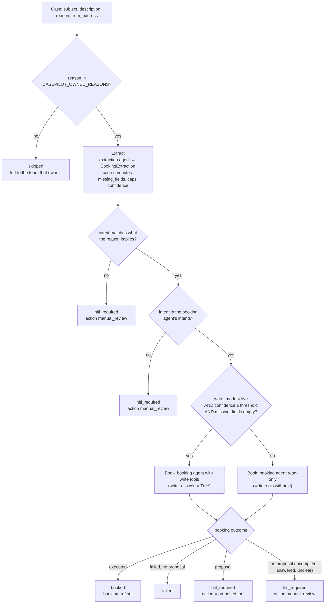
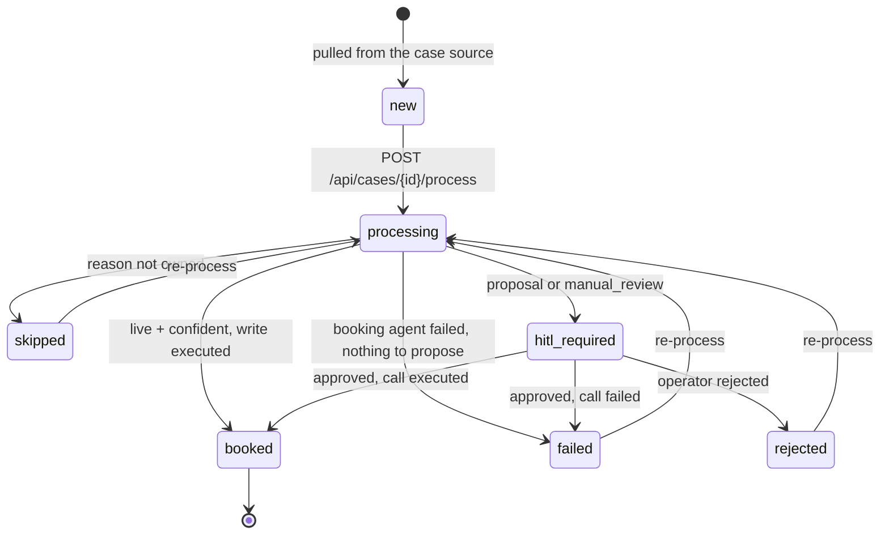

# The case pipeline
*explanation · last updated 2026-10-09*

## Purpose
How an inbound CRM case becomes a booking, a proposal for an operator, or a skip, for anyone tuning the rules,
adding a case source or reading a case's result in the admin UI.

## TL;DR
- Four steps in `app/agents/case_processor.py:process_case`: **pre-router → extract → gate → book**. No LLM
  routing hop: the case carries its own reason, and the extractor yields the intent.
- A case is processed only if its `reason` is in `CASEPILOT_OWNED_REASONS`; anything else is `skipped`.
- The booking agent may write only when **`write_mode=live` AND confidence ≥ `CASEPILOT_HITL_CONFIDENCE_THRESHOLD`
  (0.85) AND no required field is missing**. Otherwise it runs read-only and proposes the call.
- In the default shadow mode, 6 of the 8 sample cases become HITL items and 2 are skipped; none writes.
- `case_processor.py` is pure; `services/case_service.py` persists the result, opens the HITL item and writes the
  audit events.

## The four steps



### 1. Pre-router

`case.reason` must be one of `settings.owned_reasons` (default `["booking_create", "booking_amend",
"booking_cancel"]`). A case with any other reason is `skipped` with `hitl_reason = "Reason '<x>' is not owned by
this platform"`, and nothing else runs: no LLM call, no HITL item. Skipped cases keep `intent` and `confidence`
empty. The reason is matched exactly; the Salesforce adapter normalises the picklist value (`"Booking Create"` →
`booking_create`) before it gets here.

### 2. Extract

`extract_booking_request(subject, body)` (`app/agents/extraction.py`) runs the `extraction` agent once
(`max_turns=1`, model `CASEPILOT_MODEL_EXTRACTION`) and validates its JSON into `BookingExtraction`. The model
proposes; the code decides:

| Rule | Code |
|---|---|
| Unknown intent strings become `unknown` | `finalize()` |
| `missing_fields` is computed from `REQUIRED_FIELDS[intent]`, never taken from the model | `finalize()` |
| Confidence is clamped to [0, 1], then capped at `INCOMPLETE_CONFIDENCE_CAP = 0.6` if anything is missing or the intent is `unknown` | `finalize()` |

Required fields per intent:

| Intent | Required fields |
|---|---|
| `create_booking` | `origin`, `destination`, `container_type`, `container_count`, `cargo_ready_date` |
| `amend_booking` | `booking_ref`, `changes` |
| `cancel_booking` | `booking_ref` |
| `get_booking_status` | `booking_ref` |
| `track_shipment` | `booking_ref` |

Because the cap (0.6) is below the default threshold (0.85), a fluent but incomplete extraction can never clear
the gate. User content is PII-redacted before the model sees it ([architecture.md](architecture.md#safety-layers)).

The extracted intent is then cross-checked against the CRM reason through `REASON_INTENTS`
(`booking_create` → `create_booking`, `booking_amend` → `amend_booking`, `booking_cancel` → `cancel_booking`). A
mismatch, such as an "amend" case that reads as a cancellation, goes straight to HITL as `manual_review`. An owned
reason with no entry in the map skips this check. Likewise, if the extracted intent is not one of the booking
agent's `intents` (for example `track_shipment` or `unknown`), the case goes to HITL as `manual_review`.

### 3. Gate

```python
confident = extraction.confidence >= threshold and not extraction.missing_fields
write_allowed = write_mode == "live" and confident
result.shadow = not write_allowed
```

`write_mode` defaults to `CASEPILOT_WRITE_MODE` (`shadow`); `process_case(case, write_mode=...)` can override it
per call (the tests do). `threshold` is `CASEPILOT_HITL_CONFIDENCE_THRESHOLD` (0.85).

### 4. Book

The booking agent is reused, not duplicated: `run_booking_agent(subject + body, structured_request=<extracted
fields>, write_allowed=...)`. The extracted fields are appended to the message after a `STRUCTURED_REQUEST:`
marker. With `write_allowed=False` the write tools are not offered, so the agent returns a `proposed_call`
instead; `enforce_invariants` then makes the decision trustworthy whatever the model said
([hitl-and-shadow-mode.md](hitl-and-shadow-mode.md)).

How the decision maps to the case:

| Booking outcome | Case status | HITL item |
|---|---|---|
| `executed` (a write tool succeeded in this run) | `booked`, `booking_ref` set (`booked` means the booking action ran: a create, an amend or a cancel) | none |
| `failed` with no proposal | `failed` | none |
| anything else, with a `proposed_call` | `hitl_required` | `action` = the proposed tool, payload = its arguments |
| anything else, no proposal (incomplete request, or a read-only `answered` outcome) | `hitl_required` | `action = manual_review`, payload `tool`/`arguments` empty |

The HITL reason explains which rule fired: `Extraction confidence 0.60 below threshold 0.85; missing:
cargo_ready_date` when the gate failed on confidence, `Shadow mode: writes need operator approval` when the case
was confident but the platform is in shadow mode, or the agent's own reasoning in live mode.

## Case status machine



`ensure_processable` (`app/services/case_service.py`) returns **409** for a case that is `processing` or `booked`,
or that has a HITL item still `pending` or `approved`. Every other status can be processed again (for example
after changing `CASEPILOT_OWNED_REASONS` or fixing an extraction prompt). Status constants live in
`app/models/case.py`.

## The sample cases

`app/seeds/sample_cases.json` holds eight synthetic cases. The mock case source serves them, `make demo` seeds
them, and `POST /api/cases/pull` inserts any that are missing (dedupe on `external_id`). The outcomes below are
what the default configuration (mock LLM, `write_mode=shadow`, threshold 0.85) actually produces; the mock
extractor scores a single matching intent 0.93 and an ambiguous one (two intents match) 0.6.

| Case | Reason | What the email says | Extracted intent (confidence) | Shadow-mode outcome | In `live` mode |
|---|---|---|---|---|---|
| `CASE-0001` | `booking_create` | 2x40HC Rotterdam → Singapore, ready 2026-11-15, machinery parts | `create_booking` (0.93) | `hitl_required`, action `booking_create` with all six arguments; reason "Shadow mode: writes need operator approval" | `booked` (`BK-200001`) |
| `CASE-0002` | `booking_create` | 3x20GP Shanghai → Los Angeles "next month" | `create_booking` (0.60) | `hitl_required`, action `manual_review`; reason "... below threshold 0.85; missing: cargo_ready_date" | same (incomplete) |
| `CASE-0003` | `booking_amend` | Change container count to 6 on BK-100002 | `amend_booking` (0.93) | `hitl_required`, action `booking_amend` `{"booking_ref": "BK-100002", "changes": {"container_count": 6}}` | `booked` |
| `CASE-0004` | `booking_cancel` | Cancel BK-100003 | `cancel_booking` (0.93) | `hitl_required`, action `booking_cancel` `{"booking_ref": "BK-100003", "reason": "customer request"}` | `booked` |
| `CASE-0005` | `shipment_tracking` | Where is BK-100001? | not extracted | `skipped` (reason not owned) | `skipped` |
| `CASE-0006` | `invoice_dispute` | Charged twice on an invoice | not extracted | `skipped` (reason not owned) | `skipped` |
| `CASE-0007` | `booking_amend` | Cancel BK-100001 **and** book a new one Antwerp → Busan | `cancel_booking` (0.60, ambiguous) | `hitl_required`, action `manual_review`; reason "Case reason 'booking_amend' but the request reads as 'cancel_booking'" | same (mismatch) |
| `CASE-0008` | `booking_create` | 1x40RF Valencia → Busan, ready 2026-12-01, frozen fruit, plus a phone number | `create_booking` (0.93) | `hitl_required`, action `booking_create`; the phone number is redacted before extraction and in the audit trail | `booked` |

Things the samples are there to show:

- **CASE-0002**: completeness is computed in code, so a missing date forces `manual_review`. Approve it by
  supplying `tool` and `arguments` ([hitl-and-shadow-mode.md](hitl-and-shadow-mode.md#manual_review-items)).
- **CASE-0007**: a two-part request filed as an amendment. The extracted intent (`cancel_booking`) does not match
  what the CRM reason implies (`booking_amend` → `amend_booking`, see `REASON_INTENTS` in
  `app/agents/case_processor.py`), so nothing is proposed and an operator decides.
- **CASE-0005 / CASE-0006**: unowned reasons cost nothing, and stay with the team that handles them today.
- **CASE-0008**: PII never reaches the model or `audit_events` (`tests/test_api_cases_hitl.py::test_audit_payload_is_pii_redacted`).

Reproduce the table: `make demo`, then pull and process each case
([README quick start](../README.md#walk-through-case--proposal--approval--booked)), or run
`cd apps/api && uv run pytest -v tests/test_case_processor.py`.

## Related
- [hitl-and-shadow-mode.md](hitl-and-shadow-mode.md): what happens to the proposals
- [architecture.md](architecture.md): the full case-driven sequence diagram
- [configuration.md](configuration.md): `CASEPILOT_OWNED_REASONS`, `CASEPILOT_WRITE_MODE`, `CASEPILOT_HITL_CONFIDENCE_THRESHOLD`
- [temporal.md](temporal.md): the same pipeline as a durable workflow
- [api-reference.md](api-reference.md): `Case` and `CaseProcessingResult` shapes
