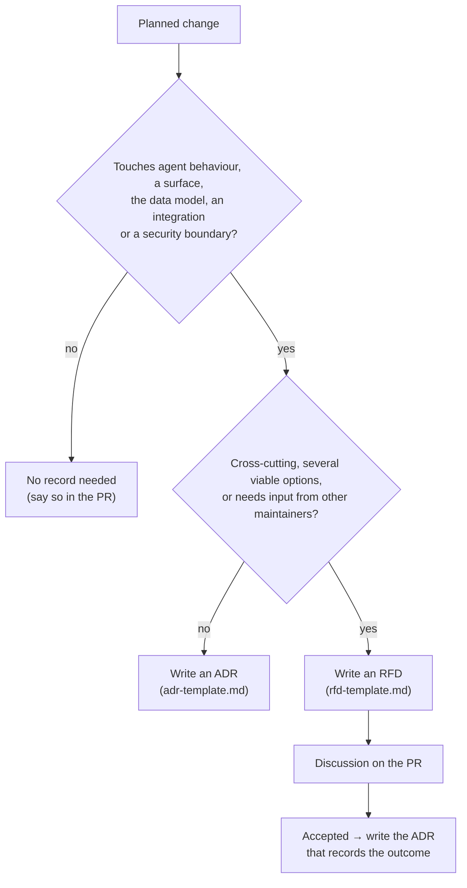

# Decision records
*explanation · last updated 2026-10-09*

## Purpose
How casepilot records architectural decisions, for anyone about to change agent behaviour, a protocol surface,
the data model, an integration or a security boundary.

## TL;DR
- **No decision trail, no merge.** A change to agent behaviour, a customer- or agent-facing surface, the data
  model, an integration or a security boundary links an ADR (or an RFD) in its PR.
- **ADR only** for a contained decision with a clear winner (one area, few alternatives).
- **RFD first, then ADR** for a big or cross-cutting decision (several areas, real trade-offs, needs discussion).
- Numbering is shared and sequential: `NNN-short-slug.md` (`001`, `002`, ...). Never reuse a number.
- Statuses: ADR `Proposed → Accepted → (Superseded | Deprecated)`; RFD `Draft → Discussion → (Accepted | Rejected | Withdrawn)`.

## Which record?

| Record | Use it for | Examples |
|---|---|---|
| ADR | One decision, recorded once it is made | Add a tool, change a threshold rule, add an adapter, add an audit event type |
| RFD | A proposal that needs discussion before deciding | A new protocol surface, replacing the runtime, multi-tenant data model, write-back to the CRM |

An implementation plan for multi-PR work lives in the ADR's **Implementation notes** section, not in a
separate plan document.

## Process

1. Copy [adr-template.md](adr-template.md) or [rfd-template.md](rfd-template.md) to `NNN-short-slug.md`, with the
   next free number across both kinds.
2. Fill it in. Lead with the decision; name real files, settings and endpoints.
3. Open the PR with status `Proposed` (ADR) or `Discussion` (RFD). For an RFD, the PR thread is the discussion.
4. On merge, set `Accepted` and the date. Link the record from the code PR (the PR template asks for it).
5. Never edit the decision of an accepted record. To change it, write a new ADR and set the old one to
   `Superseded by NNN`.

## Statuses

| Status | Meaning |
|---|---|
| Proposed | ADR under review |
| Accepted | In force; the code should match it |
| Superseded by NNN | Replaced; kept for history |
| Deprecated | No longer relevant (the feature is gone) |
| Draft / Discussion | RFD being written / being discussed |
| Rejected / Withdrawn | RFD not taken forward |

## Index

| # | Kind | Title | Status |
|---|---|---|---|
| 001 | ADR | [Pluggable agent runtime](001-pluggable-agent-runtime.md) | Accepted |
| 002 | ADR | [Confidence-gated HITL](002-confidence-gated-hitl.md) | Accepted |
| 003 | ADR | [Shadow-first write gating](003-shadow-first-write-gating.md) | Accepted |
| 004 | ADR | [Durable workflows with Temporal](004-durable-workflows-with-temporal.md) | Accepted |
| 005 | ADR | [Adapter interfaces for integrations](005-adapter-interfaces-for-integrations.md) | Accepted |

## Related
- [CONTRIBUTING.md](../../CONTRIBUTING.md)
- [docs index](../README.md)
