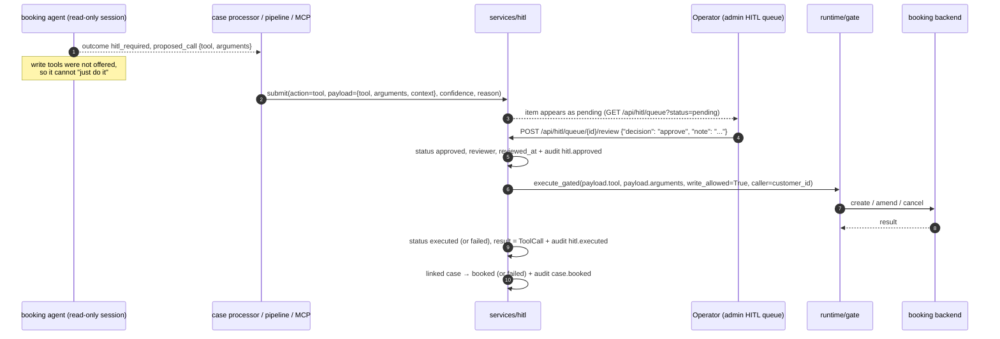
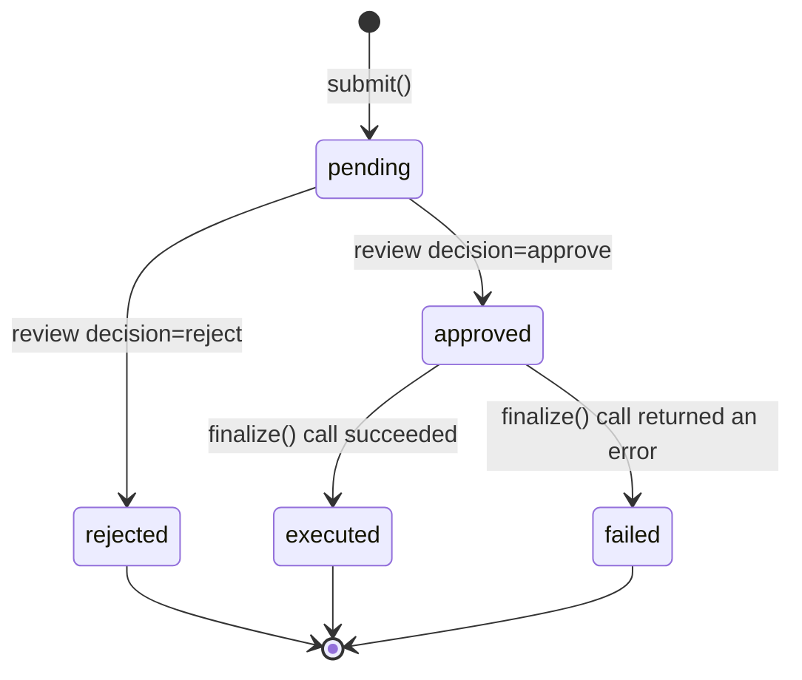
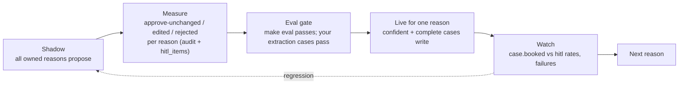

# HITL and shadow mode
*explanation · last updated 2026-10-09*

## Purpose
Why casepilot writes nothing by default, how a proposed write reaches an operator and what approval actually
runs, for operators, reviewers and anyone planning to switch a case reason to live.

## TL;DR
- **Shadow-first**: `CASEPILOT_WRITE_MODE=shadow` (default) makes case processing read-only; every write becomes
  a HITL proposal. A2A, chat and MCP are read-only in every mode.
- **Propose, then approve**: the HITL item stores `{"tool", "arguments"}`; approval runs exactly that call through
  the gate with write permission. The model is not re-run.
- **Corrections**: an operator can approve with a different `tool` and/or `arguments`; the original is kept in
  `payload.original`. A `manual_review` item has nothing to run until the operator supplies them.
- **Go-live ramp**: shadow → live per owned reason, after the eval gate, by narrowing `CASEPILOT_OWNED_REASONS`
  on a live deployment. Even in live mode, low-confidence or incomplete cases still go to HITL.
- **With Temporal**, approval signals the case workflow and the workflow runs the call in an activity.

## Why shadow-first

An agent that books containers is only useful if people trust it, and trust comes from evidence: real cases,
processed end to end, with the decision visible before anything changes in the booking system. Shadow mode
gives that evidence for free. Every owned case runs the full pipeline (extraction, the booking agent, the
proposed call), the proposal and its confidence are stored, and an operator approves or rejects it. Each review
is a labelled data point: approve-without-change means the agent was right, an edit means it was close, a reject
means it was wrong. When the numbers are good enough for a reason, that reason goes live.

The write permission itself never comes from the model. It is seeded by the platform into the session
(`SessionContext.write_allowed` in the native runtime, `cp:write_allowed` in ADK session state), and the gate
(`app/agents/runtime/gate.py`) refuses any WRITE tool without it. See
[ADR-003](decisions/003-shadow-first-write-gating.md).

| Path | Who can grant `write_allowed=True` |
|---|---|
| Case processing | `case_processor.process_case`, only if `write_mode == "live"` and the extraction is confident and complete |
| HITL approval | `services/hitl.finalize`, for exactly the approved `{tool, arguments}` |
| A2A, chat (`run_and_escalate`) | Never: always `False` |
| MCP `tools/call` | Never: a write becomes a HITL item |

## Propose, then approve



What makes the proposal trustworthy (`app/agents/booking.py:enforce_invariants`):

- `outcome = "executed"` is set only if a WRITE tool call **succeeded in this run**. A model that claims it
  booked something it did not is overruled to `hitl_required`
  (`tests/test_pipeline.py::test_model_claiming_an_unexecuted_write_is_overruled`).
- A `proposed_call` must name a real write tool (`booking_create`, `booking_amend`, `booking_cancel`); anything
  else is dropped, which turns the item into `manual_review`.
- An unknown outcome becomes `hitl_required`; a runtime error becomes `failed`, or `hitl_required` if there is a
  proposal.

And what makes approval safe (`app/services/hitl.py`):

- Approval executes the stored call. No model runs between the operator's click and the write, so the
  operator approves the exact operation, not an intention the model might reinterpret.
- It goes through the same gate as every other call, so rate limits still apply and an unknown tool fails.
- `review` refuses an item that is not `pending` (409), so an item runs at most once through the API path.

HITL item states:



Without Temporal, `approved` is transient: `review` calls `finalize` in the same request. With Temporal it lasts
until the workflow's activity runs.

### Who reviews what

| `source` | Created by | Typical `action` | After approval |
|---|---|---|---|
| `case` | `case_service.process` | proposed tool, or `manual_review` | Case → `booked` / `failed`; rejection → case `rejected` |
| `a2a` | `pipeline_service.run_and_escalate` | proposed tool, or `manual_review` | `GET /a2a/tasks/{id}` reports `completed` / `rejected` / `failed` |
| `chat` | `pipeline_service.run_and_escalate` | proposed tool, or `manual_review` | The chat shows a `CUSTOM hitl` notice linking to the item |
| `mcp` | `routers/mcp.py` on a write `tools/call` | the requested tool (confidence 1.0) | The caller can check with a read tool, e.g. `booking_status` |

## Operator corrections

The review body (`app/routers/hitl.py:ReviewRequest`):

```json
{ "decision": "approve", "note": "fixed the date", "tool": "booking_amend",
  "arguments": { "booking_ref": "BK-100002", "changes": { "container_count": 5 } } }
```

`tool` and `arguments` are optional and only used on `approve`. If either is given, the item's `payload` is
updated before it runs and the previous values are kept as `payload.original = {"tool", "arguments"}`, so the
audit trail (`hitl.approved` carries the full payload) shows both what the agent proposed and what was run.
`tool` must exist in the tool registry, otherwise the review fails with 422.

### `manual_review` items

An item whose `action` is `manual_review` has `payload.tool = null`: the agent could not produce a complete
call (missing fields, an unclear request, an intent the booking agent does not own, or a read-only answer that
still needs a human reply). Approving it without a `tool` returns **422** ("Nothing to execute"). The operator
either rejects it or approves with the full call:

```bash
curl -s -X POST http://localhost:8000/api/hitl/queue/$ITEM/review -H 'Content-Type: application/json' -d '{
  "decision": "approve",
  "tool": "booking_create",
  "arguments": {"origin": "Shanghai", "destination": "Los Angeles", "container_type": "20GP",
                "container_count": 3, "cargo_ready_date": "2026-11-20"}
}'
```

(`tests/test_api_cases_hitl.py::test_manual_review_needs_operator_supplied_call` exercises exactly this with
`CASE-0002`.)

## The go-live ramp



1. **Run shadow** on real cases. Every owned case produces a proposal; the operator's decisions are the ground
   truth. `hitl_items` holds the proposal, confidence and outcome; `audit_events` holds who did what and when.
2. **Gate on evals.** `make eval` must pass ([evals-and-ci.md](evals-and-ci.md)). Add your own cases for the reason
   you are promoting (extraction completeness, the arguments of the proposed call), and run them against the real
   model with `CASEPILOT_LLM_PROVIDER=litellm`.
3. **Flip one reason live.** `CASEPILOT_WRITE_MODE` is global and `CASEPILOT_OWNED_REASONS` decides which reasons
   are processed, so the per-reason ramp is a deployment choice: run a `live` deployment owning only the promoted
   reasons (for example `CASEPILOT_OWNED_REASONS=["booking_cancel"]`) next to a `shadow` deployment owning the
   rest, or keep a single deployment in shadow until every owned reason has passed.
4. **Live still escalates.** In live mode, a case writes on its own only if confidence ≥ the threshold and
   nothing is missing; everything else is still a HITL item with the reason spelled out.
5. **Roll back by config.** Set `CASEPILOT_WRITE_MODE=shadow` (or drop the reason) and restart; nothing else
   changes.

## How Temporal changes approval

With `CASEPILOT_TEMPORAL_ENABLED=true`, `POST /api/cases/{id}/process` starts `CaseWorkflow` (id `case-<case id>`)
instead of processing inline, and the HITL item gets the `workflow_id`. Approval then works like this:

1. `review` validates the decision and corrections, sets `approved`/`rejected`, writes `hitl.approved`/`hitl.rejected`
   and **commits**.
2. It signals the workflow (`review_submitted` with the item id) and returns. The API response shows
   `status: "approved"`, not `executed`.
3. The workflow wakes up and runs `finalize_review_activity`, which executes the approved call through the gate,
   sets `executed`/`failed` and syncs the case. Only items still `approved`/`rejected` are finalized, so a retry
   after success is a no-op.

Items from A2A, chat and MCP have no workflow and are finalized inline even when Temporal is on. Details,
timeouts and retry policies: [temporal.md](temporal.md).

## Related
- [case-pipeline.md](case-pipeline.md): how proposals are produced
- [tools-and-gating.md](tools-and-gating.md): the gate
- [temporal.md](temporal.md): durable approval
- [ADR-002](decisions/002-confidence-gated-hitl.md) and [ADR-003](decisions/003-shadow-first-write-gating.md)
- [api-reference.md](api-reference.md#human-in-the-loop): HITL endpoints
