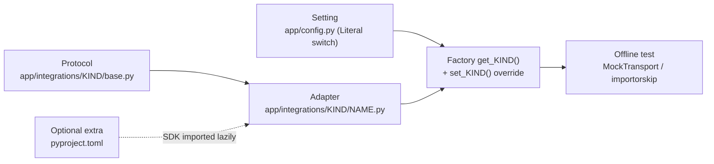

# Integrations
*reference · last updated 2026-10-09*

## Purpose
Every open-source product, protocol and managed service casepilot is built on or integrates with: what it is
used for, its licence, where it lives in the code and how to turn it on. Read it before adding a dependency,
wiring a real provider, or checking licence compatibility.

## TL;DR
- The base install (`uv sync`) runs the whole flow **offline**: mock LLM, mock case source, in-memory booking,
  tracking and memory, no-op tracer, no Temporal. No API keys, no network.
- Every external integration is an **optional extra** (`adk`, `litellm`, `langfuse`, `mem0`, `temporal`, or
  `all`) plus a `CASEPILOT_*` switch. `make install` installs all extras; switches stay off until you set them.
- Managed services (Salesforce, Bedrock, Azure OpenAI, OpenAI, Temporal Cloud, LangFuse Cloud, GHCR) are
  **never required for local development**.
- Licences below were read from installed package metadata (`.venv/.../*.dist-info/METADATA`,
  `node_modules/<pkg>/package.json`) where the package is installed; anything else is marked "(per upstream)".
- New integrations follow one pattern: `Protocol` + factory + `set_*` override + optional extra + offline test (§3).

## 1. Open-source products and libraries

Versions are the ones resolved in `apps/api/uv.lock` and `apps/admin/package-lock.json` at the time of writing.

### Backend runtime (always installed)

| Product | Category | What casepilot uses it for | Licence | Where in the code | How to enable |
|---|---|---|---|---|---|
| [FastAPI](https://fastapi.tiangolo.com) 0.141 | Web framework | Every HTTP route; dependency injection for the DB session (`get_db`) and caller identity (`get_principal`, `require_operator`) | MIT | `app/main.py`, `app/routers/*.py`, `app/security.py` | Base dependency |
| [Starlette](https://www.starlette.io) 1.7 (via FastAPI) | ASGI toolkit | `RequestIdMiddleware` (`BaseHTTPMiddleware`), `StreamingResponse` for SSE | BSD-3-Clause | `app/middleware.py`, `app/routers/agui.py` | Base dependency |
| [Uvicorn](https://www.uvicorn.org) 0.54 | ASGI server | Serves the API (`make api`, `make demo`, the Dockerfile `CMD`) | BSD-3-Clause | `Makefile`, `apps/api/Dockerfile` | Base dependency (`uvicorn[standard]`) |
| [Pydantic](https://docs.pydantic.dev) 2.14 | Validation | Request bodies (`ReviewRequest`, `TaskSendParams`, `JsonRpcRequest`, `ClassifyRequest`) and the `BookingExtraction` schema | MIT | `app/routers/*.py`, `app/agents/extraction.py` | Base dependency |
| [pydantic-settings](https://docs.pydantic.dev/latest/concepts/pydantic_settings/) 2.15 | Configuration | `Settings` read from `CASEPILOT_*` env vars or `.env` | MIT | `app/config.py` | Base dependency |
| [SQLAlchemy](https://www.sqlalchemy.org) 2.1 (asyncio) | ORM | Async engine and sessions, the `Case` / `HitlItem` / `AuditEvent` models, JSON ↔ JSONB variant type | MIT | `app/database.py`, `app/models/*.py` | Base dependency |
| [Alembic](https://alembic.sqlalchemy.org) 1.20 | Migrations | `001_initial` (tables + the Postgres append-only trigger on `audit_events`); a Postgres advisory lock serialises concurrent migrations | MIT | `apps/api/alembic/`, `apps/api/alembic.ini` | `make migrate`; the API image runs `alembic upgrade head` on start |
| [asyncpg](https://github.com/MagicStack/asyncpg) 0.32 | DB driver | PostgreSQL driver for `postgresql+asyncpg://` URLs | Apache-2.0 | `CASEPILOT_DATABASE_URL` | Default database URL |
| [aiosqlite](https://github.com/omnilib/aiosqlite) 0.22 | DB driver | SQLite for `make demo` and the test suite (`sqlite+aiosqlite://`) | MIT | `app/database.py` (StaticPool for SQLite), `tests/conftest.py` | `CASEPILOT_DATABASE_URL=sqlite+aiosqlite:///./casepilot.db` + `CASEPILOT_AUTO_CREATE_TABLES=true` |
| [PostgreSQL](https://www.postgresql.org) 16 | Database | Dev/prod database; JSONB payloads; the trigger that makes `audit_events` append-only | PostgreSQL License (per upstream) | `docker-compose.yml` (`postgres:16`), `.github/workflows/ci-api.yaml` (`migrations` job) | `make db` |
| [httpx](https://www.python-httpx.org) 0.28 | HTTP client | Salesforce OAuth + REST calls; `MockTransport` and `ASGITransport` in tests | BSD-3-Clause | `app/integrations/case_source/salesforce.py`, `tests/conftest.py`, `tests/test_integrations.py` | Base dependency |
| [PyJWT](https://pyjwt.readthedocs.io) 2.15 (`[crypto]`) | Auth | Verifies bearer tokens (HS256 secret, or RS256/ES256 via `PyJWKClient` against a JWKS URL); signs the RS256 Salesforce JWT assertion | MIT | `app/security.py`, `app/integrations/case_source/salesforce.py` | `CASEPILOT_AUTH_MODE=jwt` |
| [cryptography](https://cryptography.io) 50 (via `pyjwt[crypto]`) | Crypto | RSA/EC signature support for PyJWT | Apache-2.0 OR BSD-3-Clause | indirect | Base dependency |

### Optional backend integrations (extras, off by default)

| Product | Category | What casepilot uses it for | Licence | Where in the code | How to enable |
|---|---|---|---|---|---|
| [Google ADK](https://google.github.io/adk-docs/) (`google-adk` 2.11) | Agent runtime | Alternative runtime: a fresh `LlmAgent` on an `InMemoryRunner` per run, `GatedFunctionTool` wrapping the gate, loop and cost callbacks, `BridgeLlm` forwarding to casepilot's `LLMClient` | Apache-2.0 | `app/agents/runtime/adk_engine.py` | Extra `adk`; `CASEPILOT_AGENT_RUNTIME=adk` |
| [google-genai](https://github.com/googleapis/python-genai) 2.29 | SDK types | `types.Content`, `Part`, `FunctionCall`, usage metadata used by the ADK bridge | Apache-2.0 | `app/agents/runtime/adk_engine.py` | Installed with the `adk` extra |
| [LiteLLM](https://docs.litellm.ai) 1.104 | LLM client | `litellm.acompletion` for every provider (OpenAI, Bedrock, Azure OpenAI, Anthropic, Ollama, ...); `completion_cost` / `cost_per_token` for the cost cap; optional LiteLLM proxy mode | MIT | `app/agents/llm/litellm_client.py`, `app/agents/types.py` (`estimate_cost`) | Extra `litellm`; `CASEPILOT_LLM_PROVIDER=litellm`, `CASEPILOT_MODEL_*`, optional `CASEPILOT_LITELLM_API_BASE` |
| [LangFuse](https://langfuse.com) Python SDK (`langfuse` 4.15) | Tracing | One trace per pipeline run; nested observations per agent, tool call and LLM generation (`start_as_current_observation`) | MIT | `app/observability/langfuse_tracer.py`, `app/observability/tracer.py` | Extra `langfuse`; `CASEPILOT_LANGFUSE_ENABLED=true` + keys + host |
| [LangFuse](https://langfuse.com) server | Trace store / UI | Receives the traces; not bundled in `docker-compose.yml` (run it with LangFuse's own compose file, or use LangFuse Cloud) | MIT for the core; enterprise directories licensed separately (per upstream) | `CASEPILOT_LANGFUSE_HOST` (default `http://localhost:3000`) | Self-host per upstream docs |
| [Mem0](https://mem0.ai) open source (`mem0ai` 2.2) | Memory | `AsyncMemory.add` / `search` for semantic customer memory recalled into the orchestrator prompt | Apache-2.0 | `app/agents/memory/mem0_store.py` | Extra `mem0`; `CASEPILOT_MEMORY_BACKEND=mem0`, optional `CASEPILOT_MEM0_CONFIG_JSON` |
| [Temporal](https://temporal.io) Python SDK (`temporalio` 1.34) | Durable execution | `CaseWorkflow` (process → wait for `review_submitted` signal → finalize), activities, worker, client | MIT | `app/temporal/*.py` | Extra `temporal`; `CASEPILOT_TEMPORAL_ENABLED=true`, `make worker` |
| [Temporal](https://temporal.io) server (CLI dev server) | Durable execution | Local dev server via `temporalio/temporal` image, `server start-dev` (gRPC :7233, UI :8233) | MIT (per upstream) | `docker-compose.yml` (profile `temporal`) | `make temporal` |

### Evaluation, testing and tooling

| Product | Category | What casepilot uses it for | Licence | Where in the code | How to enable |
|---|---|---|---|---|---|
| [Promptfoo](https://www.promptfoo.dev) | Eval | Routing eval through the HTTP provider against `POST /api/agents/orchestrator/classify` | MIT (per upstream) | `apps/api/evals/promptfoo.routing.yaml`, `.github/workflows/eval-gate.yaml` | `make eval-promptfoo` (runs `npx promptfoo@latest`; needs Node) |
| [PyYAML](https://pyyaml.org) 6.0 | Dev | Loads `evals/routing.yaml` for the offline eval | MIT | `apps/api/evals/run_evals.py` | `dev` dependency group |
| [pytest](https://pytest.org) 9.1 | Tests | The offline test suite | MIT | `apps/api/tests/`, `[tool.pytest.ini_options]` in `pyproject.toml` | `make test-api` |
| [pytest-asyncio](https://github.com/pytest-dev/pytest-asyncio) 1.4 | Tests | `asyncio_mode = "auto"` async tests and fixtures | Apache-2.0 | `apps/api/pyproject.toml` | `dev` dependency group |
| [Ruff](https://docs.astral.sh/ruff/) 0.16 | Lint / format | Rules E, F, I, UP, B; line length 120; Python 3.12 target | MIT | `[tool.ruff]` in `apps/api/pyproject.toml` | `make lint`, `make format` |
| [uv](https://docs.astral.sh/uv/) | Package manager | Workspace install, lockfile, `uv run`; copied into the API image | MIT OR Apache-2.0 (per upstream) | `apps/api/pyproject.toml`, `apps/api/uv.lock`, `apps/api/Dockerfile` | `make install` |

### Admin UI (`apps/admin`)

| Product | Category | What casepilot uses it for | Licence | Where in the code | How to enable |
|---|---|---|---|---|---|
| [React](https://react.dev) 19.3 (`react`, `react-dom`) | UI library | The operator console | MIT | `apps/admin/src/` | `make admin` |
| [Vite](https://vite.dev) 8.3 (+ `@vitejs/plugin-react` 6.1) | Build / dev server | Dev server on :5173 with the API proxy (SSE-friendly rule for `/api/agui`), production build | MIT | `apps/admin/vite.config.ts` | `make admin`, `npm run build` |
| [Tailwind CSS](https://tailwindcss.com) 4.3 (+ `@tailwindcss/vite`) | Styling | Utility CSS | MIT | `apps/admin/src/index.css`, `apps/admin/vite.config.ts` | Always on in the admin |
| [React Router](https://reactrouter.com) 8.4 | Routing | Routes for Dashboard, Cases, Case detail, HITL queue, Agents & Tools, Chat (lazy), Audit log | MIT | `apps/admin/src/routes.tsx` | Always on |
| [assistant-ui](https://www.assistant-ui.com) (`@assistant-ui/react` 0.15, `@assistant-ui/react-ag-ui` 0.0.65) | Chat UI | The chat thread and its AG-UI runtime (`useAgUiRuntime`) | MIT | `apps/admin/src/features/chat/ChatThread.tsx`, `apps/admin/src/pages/ChatPage.tsx` | Chat page |
| [AG-UI](https://docs.ag-ui.com) client (`@ag-ui/client` 0.0.59, `@ag-ui/core`) | Protocol client | `HttpAgent` streaming runs from `POST /api/agui` | MIT | `apps/admin/src/features/chat/agent.ts` | Chat page |
| [lucide-react](https://lucide.dev) 1.53 | Icons | Sidebar and page icons | ISC | `apps/admin/src/layouts/AppLayout.tsx` | Always on |
| [Vitest](https://vitest.dev) 5.0 | Tests | Admin unit/component tests in jsdom | MIT | `apps/admin/vite.config.ts` (`test` block) | `make test-admin` / `npm test` |
| [Testing Library](https://testing-library.com) (`react` 16.3, `dom` 10.4, `jest-dom` 7.0, `user-event` 14.6) + [jsdom](https://github.com/jsdom/jsdom) 30 | Tests | Component rendering and interaction tests | MIT | `apps/admin/src/test/setup.ts`, `apps/admin/src/**/*.test.tsx` | `npm test` |
| [TypeScript](https://www.typescriptlang.org) 6.0 | Language | Strict type checking (`tsc -b`) | Apache-2.0 | `apps/admin/tsconfig*.json` | `npx tsc -b` |
| [ESLint](https://eslint.org) 10 + typescript-eslint 8.71 | Lint | Admin lint (react-hooks, react-refresh plugins) | MIT | `apps/admin/eslint.config.js` | `npm run lint` |

### Containers, CI and repository automation

| Product | Category | What casepilot uses it for | Licence | Where in the code | How to enable |
|---|---|---|---|---|---|
| [Docker](https://www.docker.com) Engine + Compose | Containers | Postgres and Temporal for local dev; API and admin images | Apache-2.0 (per upstream) | `docker-compose.yml`, `apps/api/Dockerfile`, `apps/admin/Dockerfile` | `make db`, `make temporal`, `docker compose --profile app up --build` |
| Base images `python:3.12-slim`, `node:24-alpine` | Containers | API runtime; admin build stage | Python: PSF-2.0; Node.js: MIT (per upstream) | `apps/api/Dockerfile`, `apps/admin/Dockerfile` | Built by `docker-publish` |
| [nginx](https://nginx.org) 1.29 (`nginx:1.29-alpine`) | Web server | Serves the admin SPA and reverse-proxies `/api`, `/a2a`, `/mcp`, `/.well-known`, `/health` (unbuffered for `/api/agui`) | BSD-2-Clause (per upstream) | `apps/admin/nginx.conf`, `apps/admin/Dockerfile` | Admin container; `API_UPSTREAM` env |
| [GitHub Actions](https://docs.github.com/actions) | CI | `ci-api`, `ci-admin`, `codeql`, `docker-publish`, `eval-gate`, `pr-title`, `stale`, `workflow-lint` | Hosted service (see upstream terms) | `.github/workflows/` | On push / PR (see [evals-and-ci.md](evals-and-ci.md)) |
| [CodeQL](https://codeql.github.com) | Static analysis | `security-and-quality` queries for Python, JavaScript/TypeScript and Actions | `codeql-action`: MIT; CodeQL CLI and queries: GitHub CodeQL terms, free for open source (per upstream) | `.github/workflows/codeql.yaml` | On push to `main`, PRs, weekly |
| [Dependabot](https://docs.github.com/code-security/dependabot) | Dependency updates | Weekly updates for uv, npm, GitHub Actions and Docker base images | Hosted service (see upstream) | `.github/dependabot.yml` | Enabled by the config file |
| [actionlint](https://github.com/rhysd/actionlint) | Workflow lint | Lints `.github/workflows/*` on PRs that touch them | MIT (per upstream) | `.github/workflows/workflow-lint.yaml` | Automatic |
| [action-semantic-pull-request](https://github.com/amannn/action-semantic-pull-request) | PR check | Enforces Conventional Commits PR titles | MIT (per upstream) | `.github/workflows/pr-title.yaml` | Automatic |

### Protocols (specifications)

| Specification | What casepilot implements | Licence | Where in the code |
|---|---|---|---|
| [A2A](https://a2a-protocol.org) (Agent2Agent) | Agent card at `/.well-known/agent.json` (one skill per registered agent); `POST /a2a/tasks/send` and `GET /a2a/tasks/{id}` as plain HTTP routes; task states `completed`, `input-required`, `failed`, `rejected` | Apache-2.0 (per upstream) | `app/routers/a2a.py` |
| [MCP](https://modelcontextprotocol.io) (Model Context Protocol) | JSON-RPC 2.0 over HTTP at `POST /mcp`: `initialize` (protocol version `2025-06-18`), `ping`, `tools/list` (scope-filtered), `tools/call` (writes become HITL items) | MIT (per upstream) | `app/routers/mcp.py` |
| [AG-UI](https://docs.ag-ui.com) (Agent–User Interaction) | `POST /api/agui` accepts a `RunAgentInput` and streams `RUN_*`, `STEP_*`, `TOOL_CALL_*`, `TEXT_MESSAGE_*` and a `CUSTOM` `hitl` event over SSE | MIT (verified from the installed `@ag-ui/core` package) | `app/protocols/agui_events.py`, `app/routers/agui.py` |

## 2. Managed services

None of these is required for local development: the defaults replace each one with a local mock or stay off.

### Salesforce (case source)

| | |
|---|---|
| For | Pulling inbound cases from a Salesforce org instead of the bundled sample cases |
| Adapter | `SalesforceCaseSource` in `app/integrations/case_source/salesforce.py`, selected by `get_case_source()` |
| Auth | OAuth 2.0 JWT bearer flow: an RS256 assertion signed with your connected app's private key, exchanged at `{login_url}/services/oauth2/token` |
| Query | `SELECT Id, Subject, Description, SuppliedEmail, Reason, CreatedDate FROM Case [WHERE CreatedDate >= <last pull> AND (<filter>)] ORDER BY CreatedDate ASC LIMIT <n>` |
| Mapping | `Id` → `external_id`, `SuppliedEmail` → `from_address`, `Reason` normalised to lowercase with underscores (`"Booking Create"` → `booking_create`) so it can match `CASEPILOT_OWNED_REASONS` |
| Env vars | `CASEPILOT_CASE_SOURCE=salesforce`, `CASEPILOT_SALESFORCE_LOGIN_URL` (default `https://login.salesforce.com`), `CASEPILOT_SALESFORCE_CLIENT_ID`, `CASEPILOT_SALESFORCE_USERNAME`, `CASEPILOT_SALESFORCE_PRIVATE_KEY_PATH`, `CASEPILOT_SALESFORCE_API_VERSION` (default `v61.0`), `CASEPILOT_SALESFORCE_CASE_FILTER` |
| Notes | Read-only: casepilot does not write back to Salesforce. Only standard fields are read; map custom fields in `SalesforceCaseSource._to_case`. Tested offline with `httpx.MockTransport` (`tests/test_integrations.py`). |
| Local dev | Not required (`CASEPILOT_CASE_SOURCE=mock` serves `app/seeds/sample_cases.json`) |

### LLM providers via LiteLLM: AWS Bedrock, Azure OpenAI, OpenAI

All three go through one adapter, `LiteLLMClient` (`app/agents/llm/litellm_client.py`), enabled with the
`litellm` extra and `CASEPILOT_LLM_PROVIDER=litellm`. The provider is chosen by the LiteLLM model string in each
model slot; credentials use LiteLLM's own standard environment variables, not `CASEPILOT_*` ones.

| Service | For | Model string in `CASEPILOT_MODEL_INTENT` / `_EXTRACTION` / `_REASONING` | Credentials (LiteLLM's variables, per upstream) |
|---|---|---|---|
| [AWS Bedrock](https://aws.amazon.com/bedrock/) | Hosted Claude, Llama, Mistral, ... | `bedrock/<model-id>` | `AWS_ACCESS_KEY_ID`, `AWS_SECRET_ACCESS_KEY`, `AWS_REGION_NAME` (or an AWS profile / role) |
| [Azure OpenAI](https://azure.microsoft.com/products/ai-services/openai-service) | GPT models in your Azure tenant | `azure/<deployment>` | `AZURE_API_KEY`, `AZURE_API_BASE`, `AZURE_API_VERSION` |
| [OpenAI](https://platform.openai.com) | GPT models | `openai/<model>` (the defaults are `openai/gpt-4o-mini` and `openai/gpt-4o`) | `OPENAI_API_KEY` |

- **Proxy mode.** Set `CASEPILOT_LITELLM_API_BASE` (and `CASEPILOT_LITELLM_API_KEY`) to send every call through a
  self-hosted LiteLLM proxy. The model string becomes the proxy's alias and is prefixed `litellm_proxy/`
  automatically, so keys, budgets and provider logging live in the proxy.
- **Cost.** `litellm.completion_cost` fills `LLMResponse.cost_usd`, which feeds the per-run cost cap
  (`CASEPILOT_MAX_COST_USD_PER_RUN`).
- **Guardrails.** casepilot's regex PII redaction and denied-topic check (`app/agents/guardrails.py`) run for every
  provider. A provider-side content filter is not wired in; add it in the LLM client if you need one.
- **Local dev.** Not required: `CASEPILOT_LLM_PROVIDER=mock` uses the deterministic `MockLLM`.

### Temporal Cloud

| | |
|---|---|
| For | Hosting the Temporal service for the durable case workflow instead of a local dev server |
| Adapter | `app/temporal/client.py:connect()` (used by the API and by the worker) |
| Env vars | `CASEPILOT_TEMPORAL_ENABLED=true`, `CASEPILOT_TEMPORAL_ADDRESS` (the gRPC endpoint shown for your namespace), `CASEPILOT_TEMPORAL_NAMESPACE` (`<namespace>.<account>`), `CASEPILOT_TEMPORAL_API_KEY` (API-key auth; implies TLS), `CASEPILOT_TEMPORAL_TLS`, `CASEPILOT_TEMPORAL_TASK_QUEUE` |
| Notes | Mutual-TLS client certificates are not wired in; use an API key. See [temporal.md](temporal.md). |
| Local dev | Not required (`CASEPILOT_TEMPORAL_ENABLED=false`, or `make temporal` for a local server) |

### LangFuse Cloud

| | |
|---|---|
| For | Hosted trace storage and UI instead of a self-hosted LangFuse server |
| Adapter | `LangfuseTracer` in `app/observability/langfuse_tracer.py`, selected by `get_tracer()` |
| Env vars | `CASEPILOT_LANGFUSE_ENABLED=true`, `CASEPILOT_LANGFUSE_PUBLIC_KEY`, `CASEPILOT_LANGFUSE_SECRET_KEY`, `CASEPILOT_LANGFUSE_HOST` (your LangFuse Cloud region URL, e.g. `https://cloud.langfuse.com`) |
| Notes | Tracing never breaks a request: `flush()` failures are logged and swallowed. Every span's input, output and metadata pass through the same PII redaction as the audit trail (the client's `mask` hook), but free text can still carry names and addresses, so treat the LangFuse project as holding customer data. |
| Local dev | Not required (`NoopTracer` by default) |

### GitHub Container Registry

| | |
|---|---|
| For | Publishing the API and admin images |
| Config | `.github/workflows/docker-publish.yaml` pushes `ghcr.io/<owner>/<repo>-api` and `ghcr.io/<owner>/<repo>-admin` on pushes to `main` and on `v*` tags (PRs build without pushing) |
| Secrets | None beyond the built-in `GITHUB_TOKEN` (the job requests `packages: write`) |
| Local dev | Not required (`docker compose --profile app up --build` builds locally) |

## 3. How to add an integration

Every integration in casepilot has the same five parts. Copy them and the new integration is offline-testable,
swappable and off by default.



| Part | Existing examples |
|---|---|
| A `Protocol` describing what the platform needs (not what the vendor offers) | `CaseSource`, `BookingBackend`, `TrackingBackend`, `LLMClient`, `MemoryStore`, `Tracer` |
| An adapter per implementation; an optional SDK is imported **inside** the adapter (or the factory branch) so the base install never needs it | `MockCaseSource` / `SalesforceCaseSource`, `MockLLM` / `LiteLLMClient`, `InMemoryStore` / `Mem0Store`, `NoopTracer` / `LangfuseTracer` |
| A factory `get_<kind>()` that picks the adapter from a `Literal` setting and caches it, plus `set_<kind>(obj \| None)` to inject a fake (or reset) | `get_case_source` / `set_case_source`, `get_llm_client` / `set_llm_client`, `get_memory` / `set_memory`, `get_tracer` / `set_tracer`, `get_booking_backend` / `set_booking_backend` |
| An optional extra in `[project.optional-dependencies]`, added to `all` | `adk`, `litellm`, `langfuse`, `mem0`, `temporal` |
| A test that runs offline: inject an `httpx.MockTransport`, or `pytest.importorskip("<sdk>")` so the core CI leg skips it | `tests/test_integrations.py` |

### Worked example: a real booking backend over HTTP

The bundled `get_booking_backend()` always returns `InMemoryBookingBackend`. To book against a real API:

**1. Write the adapter** against the existing `BookingBackend` protocol (`app/integrations/booking_backend/base.py`).
httpx is already a base dependency, so no extra is needed; for a vendor SDK you would add one.

```python
# app/integrations/booking_backend/http.py
"""HTTP booking backend: talks to a booking REST API."""

from __future__ import annotations

from typing import Any

import httpx

from app.integrations.booking_backend.base import BookingNotFound


class HttpBookingBackend:
    def __init__(self, base_url: str, token: str, transport: httpx.AsyncBaseTransport | None = None) -> None:
        self._base_url = base_url.rstrip("/")
        self._headers = {"Authorization": f"Bearer {token}"}
        self._transport = transport  # injectable for tests

    async def _request(self, method: str, path: str, **kwargs: Any) -> dict[str, Any]:
        async with httpx.AsyncClient(
            base_url=self._base_url, headers=self._headers, transport=self._transport, timeout=30
        ) as client:
            resp = await client.request(method, path, **kwargs)
        if resp.status_code == 404:
            raise BookingNotFound(path)
        resp.raise_for_status()
        return resp.json()

    async def create(self, request: dict[str, Any]) -> dict[str, Any]:
        return await self._request("POST", "/bookings", json=request)

    async def amend(self, booking_ref: str, changes: dict[str, Any]) -> dict[str, Any]:
        return await self._request("PATCH", f"/bookings/{booking_ref}", json=changes)

    async def cancel(self, booking_ref: str, reason: str = "") -> dict[str, Any]:
        return await self._request("POST", f"/bookings/{booking_ref}/cancel", json={"reason": reason})

    async def get(self, booking_ref: str) -> dict[str, Any]:
        return await self._request("GET", f"/bookings/{booking_ref}")
```

**2. Add the switch and settings** to `app/config.py` (and `.env.example`, and [configuration.md](configuration.md)),
for example `booking_backend: Literal["memory", "http"] = "memory"`, `booking_api_url: str | None = None` and
`booking_api_token: str | None = None`.

**3. Branch in the factory** (`app/integrations/booking_backend/__init__.py`), keeping `memory` the default:

```python
from app.config import settings  # add next to the existing imports


def get_booking_backend() -> BookingBackend:
    global _backend
    if _backend is None:
        if settings.booking_backend == "http":
            from app.integrations.booking_backend.http import HttpBookingBackend

            _backend = HttpBookingBackend(settings.booking_api_url, settings.booking_api_token)
        else:
            _backend = InMemoryBookingBackend()
    return _backend
```

**4. Test it offline** with a mock transport, through the gate so the test also proves write gating still applies:

```python
# tests/test_http_booking_backend.py
import httpx
import pytest

from app.agents.runtime.gate import execute_gated
from app.integrations.booking_backend import BookingNotFound, set_booking_backend
from app.integrations.booking_backend.http import HttpBookingBackend


def handler(request: httpx.Request) -> httpx.Response:
    assert request.headers["Authorization"] == "Bearer t"
    if request.method == "POST" and request.url.path == "/bookings/BK-1/cancel":
        return httpx.Response(200, json={"booking_ref": "BK-1", "status": "cancelled"})
    return httpx.Response(404)


@pytest.fixture
def backend():
    b = HttpBookingBackend("https://bookings.example.com", "t", transport=httpx.MockTransport(handler))
    set_booking_backend(b)
    yield b
    set_booking_backend(None)


async def test_cancel_goes_through_the_gate(backend):
    call = await execute_gated("booking_cancel", {"booking_ref": "BK-1"}, write_allowed=True)
    assert call.error is None and call.result["status"] == "cancelled"


async def test_unknown_booking_raises(backend):
    with pytest.raises(BookingNotFound):
        await backend.get("BK-404")
```

**5. Record the decision.** A new integration changes a system boundary, so it needs an ADR
([decisions/README.md](decisions/README.md)); [ADR-005](decisions/005-adapter-interfaces-for-integrations.md)
describes the pattern.

Things to keep in mind:

- **Make writes idempotent.** HITL approval can be retried by Temporal (see [temporal.md](temporal.md)); a backend
  that accepts an idempotency key (for example the HITL item id) turns a retried write into a no-op.
- **In-memory adapters are per process.** With Temporal, the approved write runs in the worker process, so the
  API process's in-memory booking backend will not see it. Use a real backend when you run a worker.
- **Never bypass the gate.** Tools call the adapter; nothing else should call a write method directly
  ([tools-and-gating.md](tools-and-gating.md)).

## Related
- [configuration.md](configuration.md): every switch named above
- [architecture.md](architecture.md): where the adapters sit
- [temporal.md](temporal.md): Temporal setup in detail
- [evals-and-ci.md](evals-and-ci.md): Promptfoo and the GitHub workflows
- [ADR-005](decisions/005-adapter-interfaces-for-integrations.md): the adapter-interface decision
