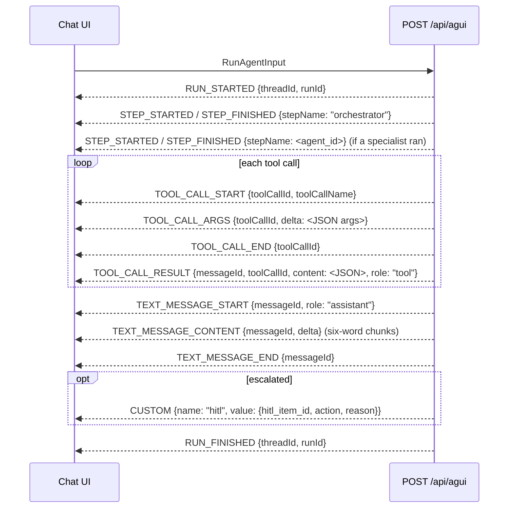

# Protocols: A2A, MCP and AG-UI
*reference · last updated 2026-10-09*

## Purpose
The wire contract of casepilot's three agent-facing surfaces, with copy-paste curl examples, for anyone
connecting an external agent, an MCP client or a chat UI.

## TL;DR

| Surface | Endpoint | Runs | Writes |
|---|---|---|---|
| A2A | `GET /.well-known/agent.json`, `POST /a2a/tasks/send`, `GET /a2a/tasks/{id}` | The orchestrator pipeline, read-only | Task comes back `input-required` with a HITL item id |
| MCP | `POST /mcp` (JSON-RPC 2.0: `initialize`, `ping`, `tools/list`, `tools/call`) | Tools directly, through the gate | Never executed; returns `{"status": "pending_approval", "hitl_item_id"}` |
| AG-UI | `POST /api/agui` (SSE) | The orchestrator pipeline, read-only | A `CUSTOM` event named `hitl` |

- Auth: `CASEPILOT_AUTH_MODE=mock` (default) needs no header and grants every scope. With `jwt`, send
  `Authorization: Bearer <token>`; the token's `sub` becomes the caller id and `scope` / `scp` its scopes.
- All examples use `API=http://localhost:8000` and the seeded in-memory bookings `BK-100001`..`BK-100003`.

## A2A

Router: `app/routers/a2a.py`. casepilot exposes A2A's agent card and the `tasks/send` / `tasks/get` operations as
plain HTTP routes (JSON bodies, no JSON-RPC envelope).

### Agent card

```bash
curl -s $API/.well-known/agent.json
```

```json
{
  "name": "casepilot",
  "description": "Case-driven logistics agent: booking and shipment tracking with human-in-the-loop writes.",
  "url": "http://localhost:8000/a2a",
  "version": "0.1.0",
  "capabilities": {"streaming": false, "pushNotifications": false, "stateTransitionHistory": false},
  "defaultInputModes": ["text"],
  "defaultOutputModes": ["text"],
  "authentication": {"schemes": []},
  "skills": [
    {"id": "booking", "name": "Booking Agent", "description": "Creates, amends, cancels and looks up container bookings; writes are HITL-gated.",
     "tags": ["create_booking", "amend_booking", "cancel_booking", "get_booking_status"]},
    {"id": "tracking", "name": "Tracking Agent", "description": "Read-only shipment visibility: milestones and ETA.",
     "tags": ["track_shipment"]}
  ]
}
```

One skill per registered `AgentPlugin` (`tags` are its intents), so a new plugin appears here automatically.
`authentication.schemes` is `["bearer"]` when `CASEPILOT_AUTH_MODE=jwt`. `url` is derived from the request's
base URL.

### `tasks/send`

```bash
# A read: answered directly
curl -s -X POST $API/a2a/tasks/send -H 'Content-Type: application/json' \
  -d '{"message": {"role": "user", "parts": [{"type": "text", "text": "Where is BK-100001?"}]}}'
```

```json
{
  "id": "<generated>", "sessionId": null,
  "status": {"state": "completed",
             "message": {"role": "agent", "parts": [{"type": "text", "text": "BK-100001: last event 'Loaded on vessel' at Rotterdam on 2026-11-02. ETA 2026-11-28."}]},
             "timestamp": "..."},
  "artifacts": [{"name": "response", "parts": [{"type": "text", "text": "BK-100001: last event ..."}]}],
  "metadata": {"intent": "track_shipment", "confidence": 0.93, "route_to": "tracking", "hitl_item_id": null}
}
```

```bash
# A write: escalated to an operator
curl -s -X POST $API/a2a/tasks/send -H 'Content-Type: application/json' \
  -d '{"id": "task-1", "sessionId": "s-1", "message": {"role": "user", "parts": [{"type": "text", "text": "Cancel booking BK-100002"}]}}'
# status.state = "input-required", metadata.hitl_item_id = "<uuid>"
```

Request body (`TaskSendParams`): `id` (optional; generated if absent), `sessionId` (optional, echoed back),
`message.parts[]` (only `type: "text"` parts are read; at least one non-empty text part is required, else 422),
`metadata` (accepted, currently unused).

### `tasks/get`

```bash
ITEM=$(curl -s $API/a2a/tasks/task-1 | jq -r .metadata.hitl_item_id)
curl -s -X POST $API/api/hitl/queue/$ITEM/review -H 'Content-Type: application/json' -d '{"decision":"approve"}'
curl -s $API/a2a/tasks/task-1 | jq '{state: .status.state, text: .artifacts[0].parts[0].text}'
# {"state": "completed", "text": "Approved and executed (BK-100002)."}
```

### State mapping

| Situation | `status.state` |
|---|---|
| Pipeline answered without escalation | `completed` |
| Pipeline needs an operator (write proposal, low confidence, unknown intent, loop) | `input-required`, `metadata.hitl_item_id` set |
| Pipeline state carries an `error` (no bundled agent sets one today) | `failed` |
| After review, HITL item `executed` | `completed` ("Approved and executed (BK-...)") |
| After review, HITL item `rejected` | `rejected` ("Operator rejected the request." plus the note) |
| After review, HITL item `failed` | `failed` |

Tasks are held in process memory (`_TASKS` in `a2a.py`): they do not survive a restart and are not shared
between replicas. Unknown task ids return 404.

## MCP

Router: `app/routers/mcp.py`. JSON-RPC 2.0 over a single HTTP `POST /mcp`, protocol version `2025-06-18`.

| Method | Result |
|---|---|
| `initialize` | `{"protocolVersion": "2025-06-18", "capabilities": {"tools": {"listChanged": false}}, "serverInfo": {"name": "casepilot", "version": "0.1.0"}}` |
| `ping` | `{}` |
| `tools/list` | `{"tools": [{"name", "description", "inputSchema", "annotations": {"readOnlyHint"}}]}`, only tools whose `scope` the caller holds |
| `tools/call` | `{"content": [{"type": "text", "text": "<JSON>"}], "isError": bool}` |
| a notification (no `id`) | HTTP 202, no body |
| anything else | error `-32601` (method not found) |

Errors: `-32602` unknown tool (or a tool without a `scope`, which is not exposed over MCP), `-32003` missing scope.

```bash
rpc() { curl -s -X POST $API/mcp -H 'Content-Type: application/json' -d "$1"; echo; }

rpc '{"jsonrpc":"2.0","id":1,"method":"initialize","params":{}}'
rpc '{"jsonrpc":"2.0","method":"notifications/initialized"}'          # 202, no body
rpc '{"jsonrpc":"2.0","id":2,"method":"tools/list"}'

# A read tool runs (through the gate, write_allowed=False)
rpc '{"jsonrpc":"2.0","id":3,"method":"tools/call","params":{"name":"booking_status","arguments":{"booking_ref":"BK-100001"}}}'
# {"jsonrpc":"2.0","id":3,"result":{"content":[{"type":"text","text":"{\"booking_ref\": \"BK-100001\", ... \"status\": \"confirmed\"}"}],"isError":false}}

# A write tool becomes a HITL item instead of running
rpc '{"jsonrpc":"2.0","id":4,"method":"tools/call","params":{"name":"booking_amend","arguments":{"booking_ref":"BK-100001","changes":{"container_count":3}}}}'
# {"jsonrpc":"2.0","id":4,"result":{"content":[{"type":"text","text":"{\"status\": \"pending_approval\", \"hitl_item_id\": \"<uuid>\"}"}],"isError":false}}
```

### Scope filtering

Each tool declares the OAuth scope an external caller needs (`@tool(..., scope="booking.read")`):

| Tool | Type | `scope` |
|---|---|---|
| `booking_create` | WRITE | `booking.create` |
| `booking_amend` | WRITE | `booking.amend` |
| `booking_cancel` | WRITE | `booking.cancel` |
| `booking_status` | READ | `booking.read` |
| `tracking_get_milestones` | READ | `tracking.read` |
| `tracking_get_eta` | READ | `tracking.read` |

```bash
# jwt mode: a token with only tracking.read sees only the two tracking tools
SECRET=dev-only-secret-change-me-0123456789   # HS256 keys should be at least 32 bytes
TOKEN=$(cd apps/api && uv run python -c "import jwt; print(jwt.encode({'sub':'agent-1','scope':'tracking.read'}, '$SECRET', algorithm='HS256'))")
curl -s -X POST $API/mcp -H "Authorization: Bearer $TOKEN" -H 'Content-Type: application/json' \
  -d '{"jsonrpc":"2.0","id":1,"method":"tools/list"}'
```

(Run the API with `CASEPILOT_AUTH_MODE=jwt CASEPILOT_JWT_SECRET=$SECRET` for this example; `tests/test_auth.py`
covers it.)

### Writes over MCP

A WRITE `tools/call` is never executed on the MCP path. It creates a HITL item with `source="mcp"`,
`action=<tool>`, `payload={"tool", "arguments", "context": {"caller": <sub>}}` and confidence 1.0 (the caller
named the exact call), and returns its id. Once an operator approves it, the call runs through the gate like any
other approval. The external agent can poll the effect with a read tool.

## AG-UI

Router: `app/routers/agui.py`; event builders: `app/protocols/agui_events.py`. The admin's Chat page consumes it
with assistant-ui's AG-UI runtime and an `HttpAgent` from `@ag-ui/client`.

`POST /api/agui` takes an AG-UI `RunAgentInput`. casepilot reads `threadId`, `runId` (both generated if
missing) and `messages`; the last `user` message is the query and up to 10 earlier `user`/`assistant` turns are
passed as history. `content` may be a string or a list of `{type: "text", text}` parts. `tools`, `context`,
`state` and `forwardedProps` are accepted and ignored.

```bash
curl -s -N -X POST $API/api/agui -H 'Content-Type: application/json' -d '{
  "threadId": "t1", "runId": "r1",
  "messages": [{"id": "m1", "role": "user", "content": "Cancel booking BK-100003"}],
  "tools": [], "context": [], "state": {}, "forwardedProps": {}
}'
```

The response is `text/event-stream`, one JSON object per `data:` frame:



Actual output for the request above:

```text
data: {"type": "RUN_STARTED", "threadId": "t1", "runId": "r1"}
data: {"type": "STEP_STARTED", "stepName": "orchestrator"}
data: {"type": "STEP_FINISHED", "stepName": "orchestrator"}
data: {"type": "STEP_STARTED", "stepName": "booking"}
data: {"type": "STEP_FINISHED", "stepName": "booking"}
data: {"type": "TEXT_MESSAGE_START", "messageId": "msg_…", "role": "assistant"}
data: {"type": "TEXT_MESSAGE_CONTENT", "messageId": "msg_…", "delta": "This needs an operator's approval before "}
…
data: {"type": "TEXT_MESSAGE_END", "messageId": "msg_…"}
data: {"type": "CUSTOM", "name": "hitl", "value": {"hitl_item_id": "<uuid>", "action": "booking_cancel", "reason": "Write tool not available in this session; proposing the call for approval."}}
data: {"type": "RUN_FINISHED", "threadId": "t1", "runId": "r1"}
```

- An empty user message, or an exception in the run, yields `RUN_STARTED` then `RUN_ERROR {message}`.
- The run completes before the first frame is sent: events are a replay of the finished pipeline, not live token
  streaming (a `TODO` in `agui.py`). The admin proxies (`vite.config.ts`, `nginx.conf`) already disable buffering
  for `/api/agui`, so live streaming would need no proxy changes.
- The admin chat turns the `hitl` event into an inline notice and a banner linking to `/hitl?item=<id>`.

## Related
- [api-reference.md](api-reference.md): every endpoint and shape
- [hitl-and-shadow-mode.md](hitl-and-shadow-mode.md): what happens after `input-required` / `pending_approval`
- [tools-and-gating.md](tools-and-gating.md): `scope` vs `agent_scopes`
- [architecture.md](architecture.md): per-surface sequence diagrams
- [integrations.md](integrations.md#protocols-specifications): the specifications
