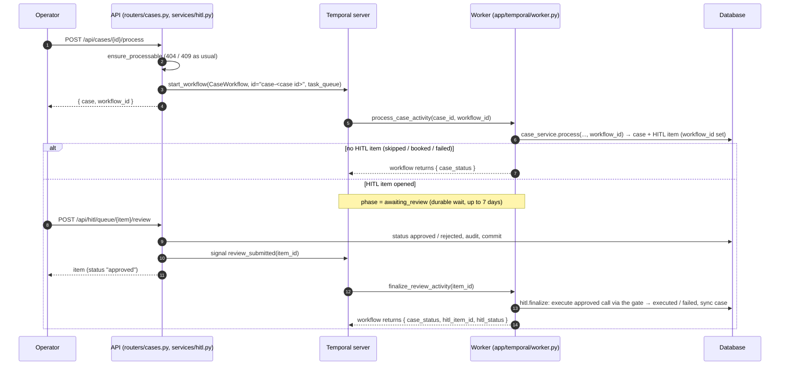

# Durable case workflows with Temporal
*explanation · last updated 2026-10-09*

## Purpose
How the optional Temporal integration runs a case as a durable workflow that can wait days for an operator and
then apply the approved write, for anyone running casepilot beyond a single process or a demo.

## TL;DR
- Off by default. Turn on with the `temporal` extra, `CASEPILOT_TEMPORAL_ENABLED=true` on **both** the API and
  the worker, a Temporal server (`make temporal`) and a worker (`make worker`).
- `CaseWorkflow` (`app/temporal/workflow.py`): `process_case_activity` → wait for the `review_submitted` signal (up
  to 7 days) → `finalize_review_activity`.
- The API starts the workflow on `POST /api/cases/{id}/process` and signals it on HITL review; the worker does the
  processing and the write.
- Activities wrap the same services as the inline path (`case_service.process`, `hitl.finalize`), so behaviour is
  identical; only *where* and *how durably* it runs changes.
- Temporal Cloud: set `CASEPILOT_TEMPORAL_ADDRESS`, `CASEPILOT_TEMPORAL_NAMESPACE` and `CASEPILOT_TEMPORAL_API_KEY`.

## Design



| Piece | File | Notes |
|---|---|---|
| Workflow | `app/temporal/workflow.py` | `@workflow.defn(name="CaseWorkflow")`; activities imported with `workflow.unsafe.imports_passed_through()` |
| Signal | `review_submitted(item_id: str)` | Sent by `app/temporal/client.py:signal_review`, called from `services/hitl.review` |
| Query | `phase` | `processing` → `awaiting_review` → `executing` → `done`, or `review_timeout` |
| Activities | `app/temporal/activities.py` | `process_case_activity(ProcessCaseInput)` → `ProcessCaseOutput(status, hitl_item_id)`; `finalize_review_activity(item_id)` → `FinalizeOutput(hitl_status, case_status)`; each opens its own session with `app.database.session_scope()` |
| Client | `app/temporal/client.py` | `connect()`, cached `get_client()`, `set_client()` for tests, `workflow_id_for(case_id) = "case-<case id>"`, `start_case_workflow`, `signal_review` |
| Worker | `app/temporal/worker.py` | `build_worker(client)` registers the workflow and both activities on `CASEPILOT_TEMPORAL_TASK_QUEUE`; `main()` loads the agent plugins first |

### The signal and run-once execution

The API never executes an approved call itself when the item belongs to a workflow: `hitl.review` commits the
decision and signals. The workflow wakes, sets `phase = executing` and runs `finalize_review_activity`.

`finalize_review_activity` only acts on an item that is still `approved` or `rejected`, so a retry after a
successful attempt finds `executed`/`failed`/`rejected` already committed and returns without calling the
backend again. `process_case_activity` is idempotent the same way: if the case already carries a HITL item
created by this workflow id, it returns that outcome instead of processing again.

The gap Temporal cannot close for you: if the worker dies **after** the backend accepted the write but **before**
the activity's commit, the retry calls the backend a second time. Give your booking backend an idempotency key
(the HITL item id is a natural one) to make that retry harmless.

### Timeout

`REVIEW_TIMEOUT = timedelta(days=7)`. If no signal arrives in time, the workflow ends with `phase =
review_timeout` and `CaseWorkflowResult(case_status=<as processed>, hitl_item_id, hitl_status="pending")`. The
HITL item stays `pending` in the database, but the workflow that would execute it is closed.

Reviewing such an item still works: `services/hitl.review` tries the signal, and when the workflow can no longer
receive it, it finalizes the item inline (runs the approved call, or applies the rejection, and updates the case)
instead of leaving it stuck at `approved` (`tests/test_api_cases_hitl.py::test_review_falls_back_inline_when_the_workflow_is_gone`).
Raise `REVIEW_TIMEOUT` if you want the workflow, not the API process, to own late approvals.

### Retry policies

| Activity | `start_to_close_timeout` | Retry policy |
|---|---|---|
| `process_case_activity` | 2 minutes | `_READ_RETRY`: up to 3 attempts, initial interval 1 s, backoff ×2 |
| `finalize_review_activity` | 2 minutes | `_WRITE_RETRY`: up to 3 attempts, initial interval 2 s, backoff ×2, non-retryable `NotFound`, `Invalid` |

`NotFound` and `Invalid` are the service errors from `app/services/errors.py`: retrying a missing item or an
invalid payload cannot succeed.

## Running locally

Temporal needs a database that both the API and the worker can reach, so use Postgres (`make db`), not the
in-memory SQLite used by tests.

```bash
make install        # includes the temporal extra (uv sync --all-extras)
make db migrate     # Postgres on :5432 + migrations
make temporal       # Temporal dev server: gRPC localhost:7233, UI http://localhost:8233

# terminal 1: worker
cd apps/api && CASEPILOT_TEMPORAL_ENABLED=true uv run python -m app.temporal.worker   # or: make worker (with the variable in apps/api/.env)

# terminal 2: API
cd apps/api && CASEPILOT_TEMPORAL_ENABLED=true CASEPILOT_SEED_ON_STARTUP=true uv run uvicorn app.main:app --port 8000
```

Then:

```bash
API=http://localhost:8000
CASE=$(curl -s "$API/api/cases?limit=20" | jq -r '.items[] | select(.external_id=="CASE-0004") | .id')
curl -s -X POST $API/api/cases/$CASE/process | jq .workflow_id         # "case-<case id>"
sleep 2
ITEM=$(curl -s $API/api/cases/$CASE | jq -r .hitl_item_id)
curl -s -X POST $API/api/hitl/queue/$ITEM/review -H 'Content-Type: application/json' -d '{"decision":"approve"}' | jq .status
# "approved": the worker executes it
sleep 2
curl -s $API/api/cases/$CASE | jq .status                                # "booked"
```

Watch the workflow, its signal and both activities in the Temporal UI at http://localhost:8233.

Things that differ from the inline path:

- `POST /api/cases/{id}/process` returns `{case, workflow_id}` with the case **before** processing; poll the case
  or the HITL queue for the result.
- The write runs in the **worker** process. The bundled in-memory booking backend is per process, so a booking
  created by the worker is not visible to `booking_status` calls served by the API. Use a real booking backend
  ([integrations.md](integrations.md#worked-example-a-real-booking-backend-over-http)) when you run a worker.
- A2A, chat and MCP HITL items have no workflow and are still finalized inline by the API.
- Audit events written by the worker have no `request_id` (there is no HTTP request in an activity).

The workflow is tested end to end on Temporal's time-skipping test server
(`tests/test_temporal_workflow.py`, skipped when the test server cannot be downloaded).

## Temporal Cloud

`app/temporal/client.py:connect()` passes `api_key` and `tls=True` when `CASEPILOT_TEMPORAL_API_KEY` is set, or
`tls=True` alone when `CASEPILOT_TEMPORAL_TLS=true`.

```bash
CASEPILOT_TEMPORAL_ENABLED=true
CASEPILOT_TEMPORAL_ADDRESS=<namespace>.<account>.tmprl.cloud:7233   # use the gRPC endpoint shown for your namespace
CASEPILOT_TEMPORAL_NAMESPACE=<namespace>.<account>
CASEPILOT_TEMPORAL_API_KEY=<api key>
CASEPILOT_TEMPORAL_TASK_QUEUE=casepilot
```

Set the same values on the API and on every worker. The API image doubles as the worker image: run it with
`python -m app.temporal.worker` instead of the default command. Mutual-TLS client certificates are not wired in.

## Related
- [hitl-and-shadow-mode.md](hitl-and-shadow-mode.md#how-temporal-changes-approval)
- [case-pipeline.md](case-pipeline.md)
- [configuration.md](configuration.md#temporal)
- [ADR-004](decisions/004-durable-workflows-with-temporal.md)
