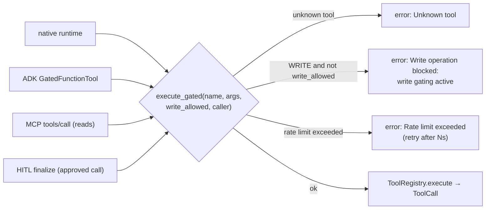

# Tools and gating
*reference · last updated 2026-10-09*

## Purpose
How a tool is declared, who may call it, and the single gate every call passes through, for anyone writing a
tool, changing a safety rule or swapping the agent runtime.

## TL;DR
- Declare a tool with `@tool(name, description, operation_type=READ|WRITE, agent_scopes=[...], scope="...")`
  (`app/agents/tools.py`). Its JSON schema is derived from the function signature.
- **`agent_scopes`** = which agents are offered the tool. **`scope`** = the OAuth scope an external caller needs
  to see or call it over MCP. They are independent.
- **`app/agents/runtime/gate.py:execute_gated`** is the one choke point: unknown tool → error; WRITE without
  `write_allowed` → `"Write operation blocked: write gating active"`; then a per-`(tool, caller)` rate limit.
- The loop guard stops a run on 3 rules (same call 3× in the last 5; A-B-A-B; same tool 5× in a row).
- The native runtime and the Google ADK runtime honour the same contract; agents call `run_agent` and never know
  which one ran.

## Declaring a tool

```python
from typing import Any

from app.agents.tools import tool
from app.agents.types import OperationType
from app.integrations.booking_backend import get_booking_backend


@tool(
    "booking_cancel",                      # name: registry key, MCP tool name, rate-limit key
    "Cancel an existing booking.",         # description: shown to the model and in tools/list
    operation_type=OperationType.WRITE,    # READ (default) or WRITE
    agent_scopes=["booking"],              # agents that may be offered it
    scope="booking.cancel",                # OAuth scope for MCP; None = not exposed over MCP
)
async def booking_cancel(booking_ref: str, reason: str = "") -> dict[str, Any]:
    return await get_booking_backend().cancel(booking_ref, reason)
```

(`app/agents/booking_tools.py`.) Tools register at import time, so the module must be imported by something
that `load_plugins()` loads: the bundled agents import their tool modules (`from app.agents import booking_tools`).
Tools may be sync or async; the registry records which.

### Arguments

| Field | Meaning |
|---|---|
| `name` | Defaults to the function name. Must be unique: a second registration with the same name replaces the first. |
| `description` | Defaults to the docstring. |
| `operation_type` | `OperationType.READ` or `OperationType.WRITE`. WRITE tools are gated and are only offered in write-permitted sessions. |
| `agent_scopes` | Agent ids allowed to use the tool. **Empty means every agent**, including the orchestrator and the extractor, so always set it. |
| `scope` | OAuth scope required over MCP. Tools with `scope=None` are invisible on `tools/list` and `tools/call` returns "Unknown tool". |

### Schema derivation

`_build_schema(func)` turns the signature into a JSON Schema `parameters` object:

| Annotation | JSON type |
|---|---|
| `str` | `string` |
| `int` | `integer` |
| `float` | `number` |
| `bool` | `boolean` |
| `list`, `list[X]` | `array` |
| `dict`, `dict[K, V]` | `object` |
| `X \| None` / `Optional[X]` | the type of `X` |
| anything else, or missing | `string` |

Parameters without a default are `required`. Parameters named `self`, `ctx`, `context` or `session` are skipped.
Item types and nested shapes are not described, so put details the model needs in the description.

Argument keys starting with `_` (for example a framework-injected `_call_id`) are stripped before the function is
called.

### Resolution helpers

| Helper | Returns |
|---|---|
| `ToolRegistry.get_scoped_tools(agent, OperationType.READ)` | READ tools the agent may use (what a read-only session is offered) |
| `ToolRegistry.get_scoped_tools(agent, OperationType.WRITE)` | READ and WRITE tools the agent may use |
| `ToolRegistry.write_tools_for(agent)` | WRITE tools the agent may use (the booking prompt lists these as proposable) |
| `ToolRegistry.to_openai_tools(tools)` | OpenAI function-calling format, which both LiteLLM and the ADK bridge consume |
| `ToolRegistry.all()` | Everything (`GET /api/tools`, MCP `tools/list` before scope filtering) |

## The gate



Every path that runs a tool calls `execute_gated`, and nothing else calls `ToolRegistry.execute`:

| Caller | `write_allowed` | `caller` (rate-limit key) |
|---|---|---|
| Native runtime (`runtime/native.py`) | `SessionContext.write_allowed` | `SessionContext.customer_id` |
| ADK runtime (`runtime/adk_engine.py`, `GatedFunctionTool.run_async`) | session state `cp:write_allowed` | session state `cp:customer_id` |
| MCP `tools/call` (READ tools only) | `False` | token `sub` |
| HITL approval (`services/hitl.finalize`) | `True` | the item's `customer_id` |

Errors are returned as a `ToolCall` with `error` set, never raised, so the model sees the refusal as a tool
result. The booking agent's mock script reacts to the "write gating" error by proposing the call instead.

### Rate limits

`app/agents/rate_limit.py`: a thread-safe, in-process sliding window per `(tool, caller)`.

| Tool | Limit |
|---|---|
| `booking_create`, `booking_amend`, `booking_cancel` | 2 requests / 1 s |
| `booking_status`, `tracking_get_milestones`, `tracking_get_eta` | 10 requests / 1 s |
| any other tool | unlimited |

Add a limit for a new tool with `DEFAULT_LIMITS["my_tool"] = RateLimitConfig(max_requests=..., window_seconds=...)`
at import time. The window is per process; it is a backstop behind whatever gateway limits you run, not a
replacement for them.

## Loop guard

`app/agents/graphs/loop_guard.py:check_loop(recent_tool_calls)` is a pure function shared by both runtimes and
the graph shim (`loop_guard_node` runs first in every graph):

| Rule | Fires when |
|---|---|
| 1. Repeated call | The same `(tool, arguments)` appears 3+ times in the last 5 calls |
| 2. Ping-pong | The last 4 calls alternate A-B-A-B (A ≠ B) |
| 3. Same tool | The same tool is called 5 times in a row, whatever the arguments |

Fewer than 3 calls never loops. On a hit the native runtime returns `AgentStatus.LOOP_DETECTED`; the ADK runtime
returns an error to the tool call, sets `cp:loop_detected` and short-circuits the next model turn. Either way the
agent's node sees a run error and escalates. Across a pipeline, `loop_guard_node` checks the accumulated
`recent_tool_calls` before each graph; if it fires, `run_pipeline` returns `hitl_required` with reason
"Agent loop detected".

## Other per-run limits

| Limit | Default | Result |
|---|---|---|
| `AgentConfig.max_turns` | 6 (extraction uses 1) | `AgentStatus.MAX_TURNS` |
| `CASEPILOT_MAX_COST_USD_PER_RUN` (`TokenBudget`) | 0.50 USD per `run_agent` call | `AgentStatus.COST_EXCEEDED` |
| Input guardrail (`check_input` on user turns) | denied topics: "weapons smuggling", "sanctions evasion", "bypass customs" | `AgentStatus.BLOCKED` |
| Output guardrail (`check_output` on the final answer) | same topics; PII redacted | `AgentStatus.BLOCKED`, or redacted output |

## Runtimes: native vs ADK

`app/agents/runtime/engine.py:run_agent(config, messages, ctx, budget) -> AgentResult` dispatches on
`CASEPILOT_AGENT_RUNTIME`:

| | `native` (default) | `adk` (extra `adk`) |
|---|---|---|
| Loop | `run_native`: model → gated tool calls → loop check → feed results back | A fresh `LlmAgent` on an `InMemoryRunner` per run, `RunConfig(max_llm_calls=max(2, max_turns * 2))` |
| Model | `get_llm_client()` (mock or LiteLLM) | `BridgeLlm`, an ADK `BaseLlm` that forwards to the same `get_llm_client()` |
| Tools offered | `get_scoped_tools(agent, READ or WRITE)` | the same list, each wrapped in `GatedFunctionTool` |
| Write permission | `SessionContext.write_allowed` | session state `cp:write_allowed`, seeded from the same `SessionContext` |
| Loop guard | `check_loop` after each tool call | `before_tool_callback` (`check_loop`) + `before_model_callback` stop |
| Cost | `TokenBudget.add` per turn | `after_model_callback` accumulates tokens and `cost_usd` in session state |
| Guardrails | `guard_inbound` + `check_output` | same functions |
| Tracing | `llm:*` and `tool:*` spans | the `agent:*` span from `run_agent` |
| Result | `AgentResult` | `AgentResult` |

Both runtimes pass the same tests for routing, proposals, executed writes and write gating
(`tests/test_integrations.py::test_adk_runtime_runs_the_same_flow`, `::test_adk_runtime_still_gates_writes`).
The ADK runtime keeps no state between runs; prior turns are folded into the new message.

## Related
- [agent-plugin-contract.md](agent-plugin-contract.md): using tools in a new agent
- [hitl-and-shadow-mode.md](hitl-and-shadow-mode.md): what happens to a blocked write
- [protocols.md](protocols.md#mcp): `scope` on the MCP surface
- [architecture.md](architecture.md#safety-layers): all safety layers in one table
- [ADR-001](decisions/001-pluggable-agent-runtime.md), [ADR-003](decisions/003-shadow-first-write-gating.md)
